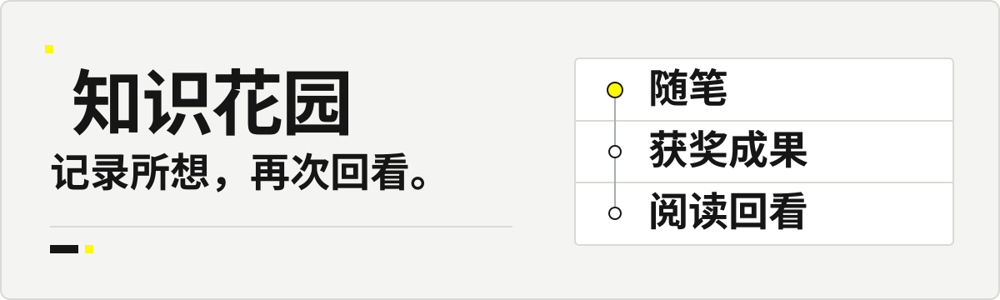
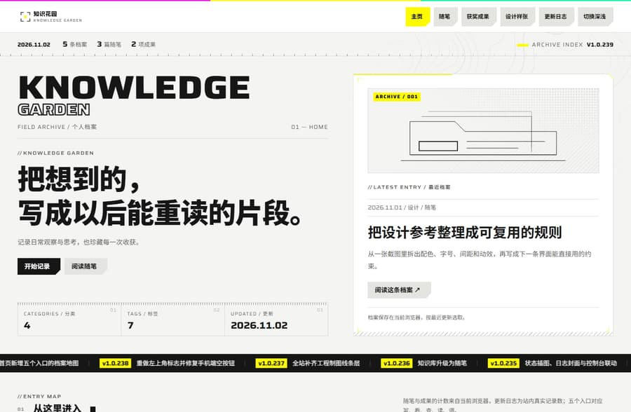
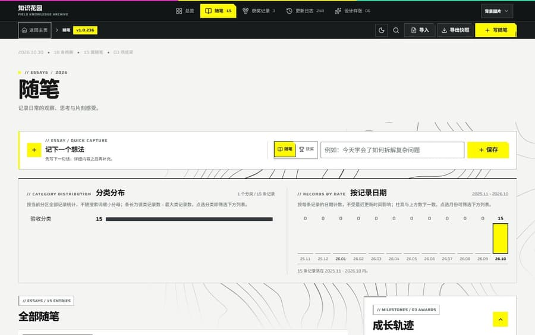
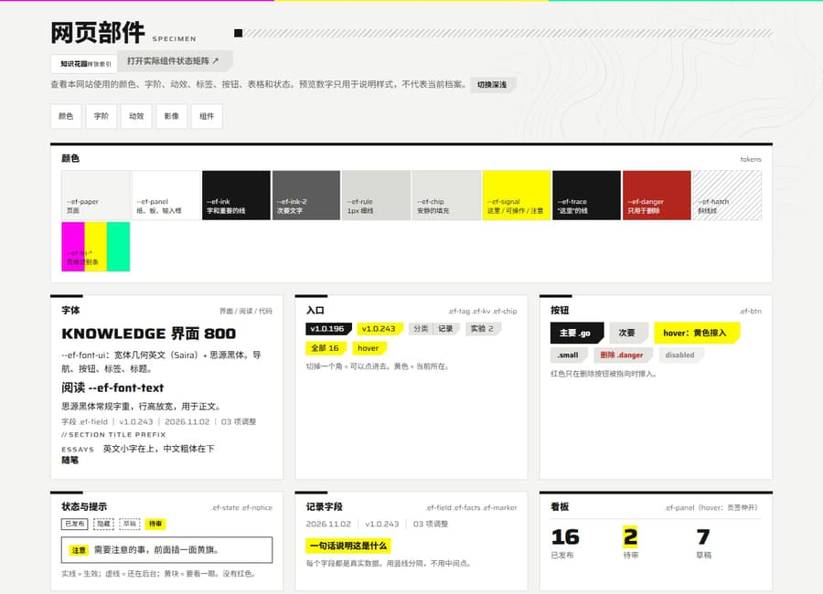
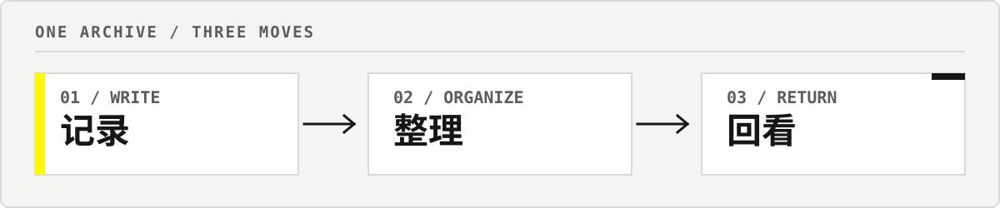
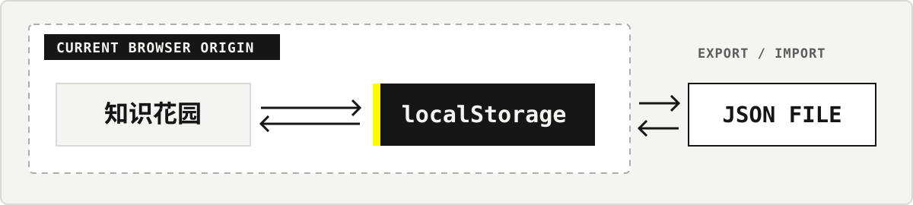

<p align="center">
  
</p>

<p align="center">
  <a href="https://r1cardo-ai.github.io/knowledge-garden-site/">打开网站</a> &nbsp;·&nbsp;
  <a href="https://knowledge-garden-site.pages.dev/">Cloudflare Pages</a> &nbsp;·&nbsp;
  <a href="https://github.com/R1cardo-ai/knowledge-garden-site">源码仓库</a>
</p>

<p align="center"><code>DESKTOP FIRST</code> &nbsp; <code>LOCAL-FIRST</code> &nbsp; <code>ESSAYS + AWARDS</code> &nbsp; <code>v1.0.249</code></p>

**Knowledge Garden（知识花园）**是一座属于个人的随笔与成果档案。写下日常观察和想法，整理获奖经历，再通过搜索、关联与独立阅读把它们找回来。

## 01 / 站点实况

界面由真实档案结构驱动：随笔、获奖成果、目录筛选、独立阅读、更新记录和设计样张，各自有明确入口。以下验收截图中的记录来自隔离样例数据，不是访问者的浏览器档案。

### 首页 · 写下与发现

[](assets/readme/screenshots/home-900.jpg)

<sub>HOME / 浅色主题 / 1440px / v1.0.239 验收样例</sub>

### 随笔目录 · 搜索与整理

[](assets/readme/screenshots/archive-900.jpg)

<sub>ESSAYS / 浅色主题 / 1440px / v1.0.236 隔离数据验收</sub>

### 组件样张 · 设计系统与页面状态

[](assets/readme/screenshots/specimen-900.jpg)

<sub>UI SPECIMEN / 浅色主题 / 1440px / v1.0.243</sub>

## 02 / 从记录到回看

<p align="center"></p>

- **记录**：创建随笔或获奖成果，补充日期、分类、标签、来源、摘要和正文。
- **整理**：按关键词、分类、形式和日期筛选；用精选与关联记录建立自己的阅读路径。
- **回看**：独立阅读页保留全文、章节导航与相关记录；版本页记录每次产品更新。
- **迁移**：通过 JSON 导入和导出，自己保留备份并决定迁移时机。

## 03 / 你的档案，留在你的浏览器

<p align="center"></p>

档案保存在当前浏览器来源的 `localStorage` 中，不会上传到 Git 仓库，也不会自动同步到其他设备、域名或端口。编辑中的草稿会自动留在本机，档案页顶部会显示上次导出时间并在超过 14 天时提醒；导入快照时可以选择合并或替换。更换浏览器或迁移站点前，请先导出 JSON 备份。完整步骤见[档案与素材操作指南](docs/档案-本地操作与素材.md)。

## 04 / 快速开始

需要 **Node.js 22.13 或更高版本**。

```sh
npm ci
npm run dev -- --host 127.0.0.1
```

开发服务器会在终端显示本地地址。构建和预览生产版本：

```sh
npm run build
npm start -- --ip 127.0.0.1 --port 5201
```

部署构建：Cloudflare Pages 使用 `npm run build:pages`；GitHub Pages 使用 `npm run build:github`。更多命令见 [`package.json`](package.json)。

## 05 / 技术构成

| 界面 | 样式 | 发布 |
| --- | --- | --- |
| React 19 · TypeScript · Vinext · Vite | Tailwind CSS 4 | Cloudflare Pages · GitHub Pages |

当前版本 **v1.0.249**。版本号与完整更新记录以 [`app/archive/page.tsx`](app/archive/page.tsx) 为准。

## 06 / 项目地图

- **了解项目**：[当前桌面状态与验收](docs/现状-桌面验收.md) · [项目手册](docs/项目-手册.md)
- **设计资料**：[设计规范与规划](docs/设计-规范与规划.md) · [外部设计参考](docs/设计-外部参考.md)
- **个人档案**：[档案操作与素材指南](docs/档案-本地操作与素材.md)
- **完整记录**：[产品更新日志](app/archive/page.tsx) · [历史验收汇编](docs/validation/验收-历史记录汇编.md)

## 07 / 致谢

**产品与数字花园参考**： [Capacities](https://capacities.io/) · [Tana](https://outliner.tana.inc/) · [Craft](https://www.craft.do/) · [Are.na](https://www.are.na/about) · [Andy Matuschak 的公开笔记](https://notes.andymatuschak.org/) · [Notion](https://www.notion.com/product/features) · [Obsidian](https://obsidian.md/help/plugins/graph) · [Amytis](https://github.com/Rongkangqi/amytis) · [Zettelgarden](https://zettelgarden.com/app) · [Roam Garden](https://labrisa.roam.garden/) · [C4ss1us Digital Garden](https://c4ss1usgarden.vercel.app/) · [Recurse](https://www.recurse.cc/) · [Conception](https://conception.app/) · [DO Knowledge Studio](https://github.com/d-oit/do-knowledge-studio) · [Mindweave](https://www.mindweave.space/) · [Notis+](https://abduzeedo.com/notis-ai-workspace-ux-ui-design-dashboard-done-quietly/) · [Cosmind](https://www.simonenegro.com/project/cosmind) · [AI Second Brain](https://github.com/balabhadra3141/AI-Second-Brain)。

**视觉研究**：[《明日方舟：终末地》官方网站](https://endfield.hypergryph.com/)。本站参考其工程信息设计，不使用游戏图片、角色立绘或标志。

**技能作者**：[hhikr](https://github.com/hhikr)（[endfield-ui](https://github.com/hhikr/endfield-ui-skill)） · [Brandon030722](https://github.com/Brandon030722)（[ark-ui](https://github.com/Brandon030722/ark-ui-skill)）。更多来源与素材说明见[外部设计参考](docs/设计-外部参考.md)。