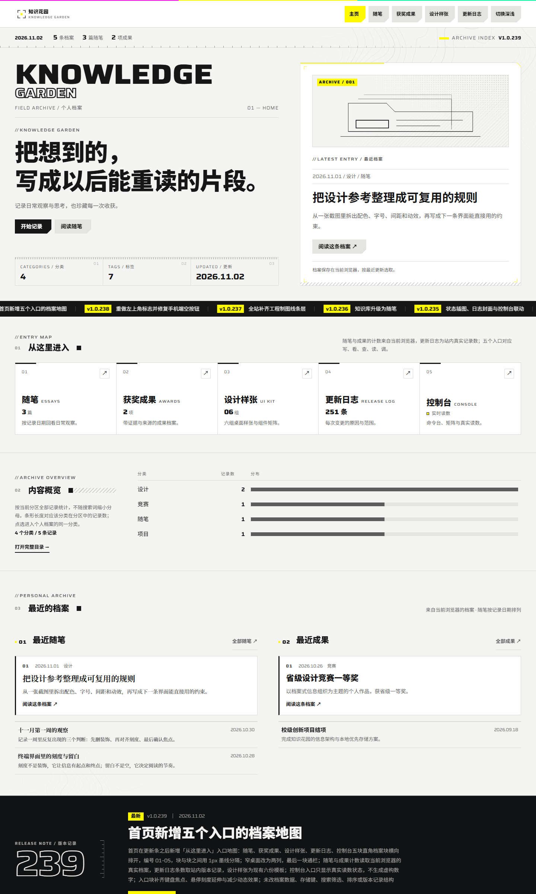
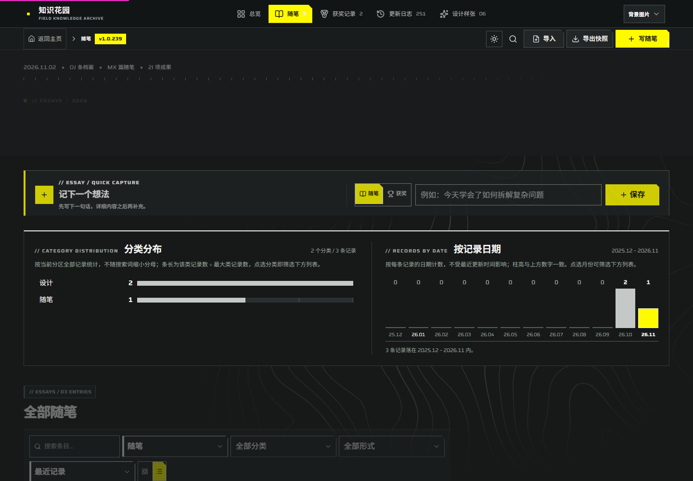
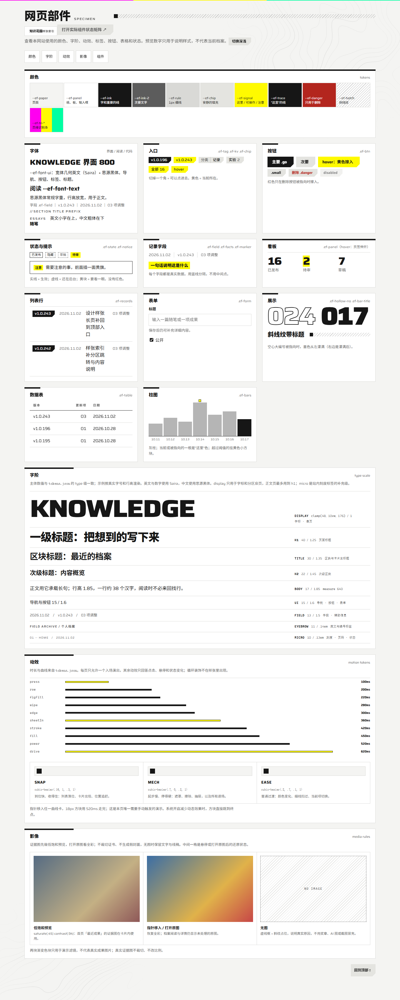

# Knowledge Garden

**Knowledge Garden（我的知识花园）**是一款桌面优先的个人随笔与成果档案网站。它把写作、成果记录和阅读整理放在一个可本地运行的界面中，采用 Endfield 风格的纸面色彩、工程线条和清晰分区。

- **在线预览**：[GitHub Pages](https://r1cardo-ai.github.io/knowledge-garden-site/) · [Cloudflare Pages](https://knowledge-garden-site.pages.dev/)
- **当前产品版本**：v1.0.245（版本与完整更新日志以 [`app/archive/page.tsx`](app/archive/page.tsx) 为准）
- **项目语言**：界面为简体中文，源码与样张包含中英文内容

## 功能

- 记录、编辑、搜索和整理随笔及获奖成果；支持分类、形式、日期、标签和关联记录。
- 在首页查看真实档案概览、精选成果、最近记录、更新信息和常用入口。
- 在独立阅读页查看记录正文、章节导航与相关记录。
- 导入、导出个人档案，并在浏览器中保存主题和首页精选偏好。
- 查看设计样张、完整版本更新日志与档案状态控制台。

## 本地运行

需要 Node.js 22.13 或更高版本。

```sh
npm ci
npm run dev -- --host 127.0.0.1
```

开发服务器启动后，按终端显示的地址打开网站。生产构建与本地预览：

```sh
npm run build
npm start -- --ip 127.0.0.1 --port 5201
```

常用项目命令可在 [`package.json`](package.json) 中查看。Cloudflare Pages 静态构建使用 `npm run build:pages`，GitHub Pages 静态构建使用 `npm run build:github`。

## 个人档案与隐私

随笔和成果保存在**当前浏览器来源的 localStorage** 中。档案不会随源码提交到 GitHub，也不会自动同步到其他设备、域名或端口。更换浏览器或迁移网站前，请先从网站导出档案备份；操作说明见[档案与素材操作指南](docs/档案-本地操作与素材.md)。

## 技术栈

- React 19、TypeScript、Vinext 与 Vite
- Tailwind CSS 4
- Cloudflare Workers / Pages 静态部署
- GitHub Pages 静态发布

## 项目文档

- [项目手册](docs/项目-手册.md)：项目约束、权威信息来源与版本要求
- [当前桌面状态与验收](docs/现状-桌面验收.md)：最新实现、验证和发布情况
- [设计规范与规划](docs/设计-规范与规划.md) · [外部设计参考](docs/设计-外部参考.md)
- [桌面视觉化 UI 规划](docs/规划-桌面视觉化UI升级_2026-10-29.md) · [知识库改为随笔规划](docs/规划-知识库改为随笔_2026-10-29.md)
- [档案与素材操作指南](docs/档案-本地操作与素材.md)
- [待办事项](docs/待办-v1.0.232.md)
- [历史记录](docs/archive/历史-2026-10.md) · [验收记录汇编](docs/validation/验收-历史记录汇编.md)

项目协作约定见 [`AGENTS.md`](AGENTS.md)。

## 页面截图

以下截图来自项目的桌面验收记录，展示首页、档案页和设计样张页面。

### 首页



### 档案页



### 设计样张



## 致谢

感谢以下网站提供产品结构、知识组织和视觉表达方面的参考： [Capacities](https://capacities.io/)、[Tana](https://outliner.tana.inc/)、[Craft](https://www.craft.do/)、[Are.na](https://www.are.na/about)、[Andy Matuschak 的公开笔记](https://notes.andymatuschak.org/)、[Notion](https://www.notion.com/product/features)、[Obsidian](https://obsidian.md/help/plugins/graph)、[Amytis](https://github.com/Rongkangqi/amytis)、[Zettelgarden](https://zettelgarden.com/app)、[Roam Garden](https://labrisa.roam.garden/)、[C4ss1us Digital Garden](https://c4ss1usgarden.vercel.app/)、[Recurse](https://www.recurse.cc/)、[Conception](https://conception.app/)、[DO Knowledge Studio](https://github.com/d-oit/do-knowledge-studio)、[Mindweave](https://www.mindweave.space/)、[Notis+](https://abduzeedo.com/notis-ai-workspace-ux-ui-design-dashboard-done-quietly/)、[Cosmind](https://www.simonenegro.com/project/cosmind) 与 [AI Second Brain](https://github.com/balabhadra3141/AI-Second-Brain)。工业档案式的信息设计研究参考了[《明日方舟：终末地》官方网站](https://endfield.hypergryph.com/)；本站未使用其游戏图片、角色立绘或标志。

感谢技能作者 [hhikr](https://github.com/hhikr) 的 [endfield-ui](https://github.com/hhikr/endfield-ui-skill)，以及 [Brandon030722](https://github.com/Brandon030722) 的 [ark-ui](https://github.com/Brandon030722/ark-ui-skill)，为界面设计与实现工作流提供参考。完整的设计观察与素材说明见[外部设计参考](docs/设计-外部参考.md)。
