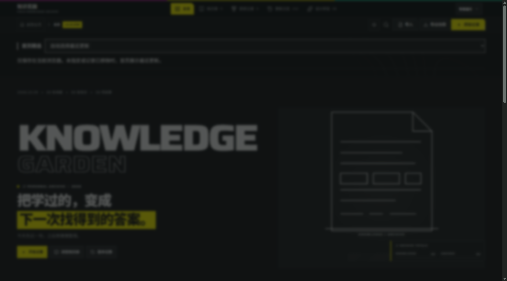
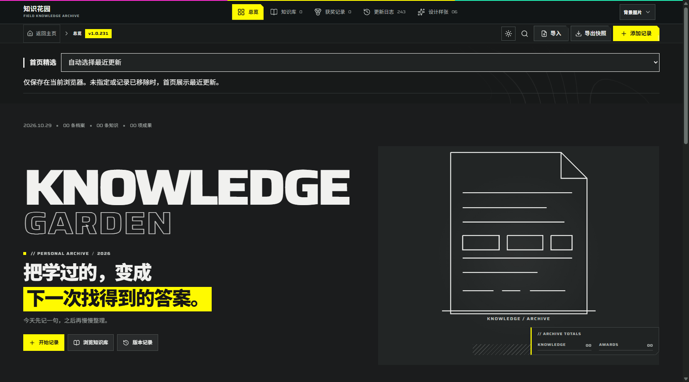
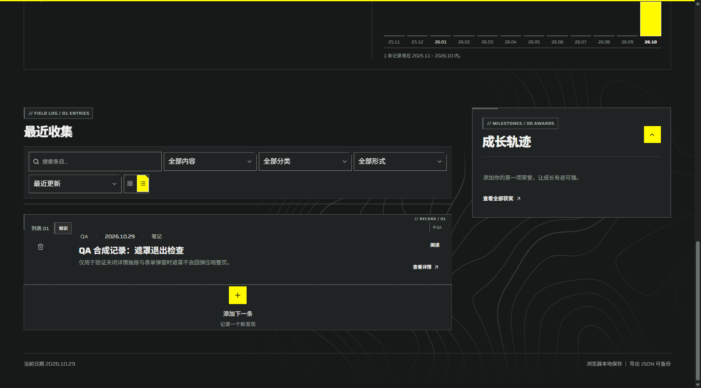

# 逐版本验收记录汇编

## v1.0.234 阅读封面与关联示意验收

2026-10-29。本批阅读页新增封面、摘要和元数据的层级；真实正文标题依出现顺序编号，保留原章节锚点。关联示意只显示当前快照中已绑定且可解析的目标，去重后最多六个节点，完整文字列表保留已删除或未绑定目标。

隔离数据 `qa-0`：超长中文标题、两章、长英文关联目标、缺失目标、长 URL 与代码。1280px 浏览器测得正文编号 01/02、目录锚点 `#note-section-0` / `#note-section-2`、示意 1 节点 1 连线、缺失说明可见、整页无横向溢出；整页截图在 `v1.0.234-reader/reader-long-light-1280.png`。临时视口覆盖没有生效，未将 720px 等效视口或真实 125% / 150% / 200% 缩放记为通过。

`npm run check:updates`、lint、类型检查、`npm test`、生产构建、Cloudflare Pages 和 GitHub Pages 静态导出及本地生产 HTTP 31 请求均通过。发布提交、托管结果及线上核对在同目录 `deployment.json` 记录。

按原文件逐节完整保留文字；截图、JSON 和其他证据仍在原目录。历史记录不代表当前产品状态。

## 原始 Markdown 合并记录

<a id="source-1437e61fd14a"></a>

<details>
<summary>docs/validation/v1.0.205-browser.md</summary>

# 生产浏览器验收记录 · v1.0.205

日期：2026-10-28（Asia/Shanghai）。环境：127.0.0.1:5201，默认 npm build / npm start 生成的 Worker，IAB tab 5。合成快照与用户原地址的数据隔离。

## 本轮实际通过

- 重置 CUA JS 会话后，browser.user is unavailable 消失；旧页仍显示 v1.0.200，因此转到真实生产地址验证 v1.0.205，而非复用旧页面内容。
- 通过页面导入控件选择 version 1 合成快照，导入后显示 2 档案、1 知识、1 成果。
- 点击卡片阅读，地址为 /archive?entry=qa-long；正文包含三个真实标题，目录为第一章、第二节、第二章。
- HTML 样式的笔记文本 <script>不应执行</script> 以可见文本显示。
- 点击关联链接到 entry=qa-award，短笔记没有章节目录。
- 点击阅读页编辑，将成果标题修改为“隔离成果 · 已改名”，保存后阅读标题更新。
- 浏览器后退到长文，关联链接显示新标题，href 仍为 /archive?entry=qa-award；刷新后目录仍完整。
- 360/390/430px，viewport 高 844px，DOM 读取的页面 scrollWidth 分别 350/380/420px；阅读容器分别 314/344/384px，目录与正文单列。430px 截图已视觉查看，未出现横向溢出。
- 恢复默认 viewport 后重新导入原快照，站内覆盖框明确显示 2 条替换 2 条；点击取消。取消后的链接校验和导出动作所在批次因下载事件等待导致 CUA 会话异常重置，故取消结果不能仅凭操作意图记为通过。

## 工具中断与证据边界

- 首次恢复默认 viewport 后 filechooser 等待超时，检查 DOM 确认仍在阅读页；再次点击导入时正常得到 chooser 和覆盖框。
- 导出动作的 download 事件等待 10 秒超时并重置了 CUA 会话。没有取得本地下载文件，因此本轮未证明快照下载内容。不能由事件超时断言网站导出失败。
- 截图只在工具输出中查看，尚未生成带版本/宽度标注的本地截图证据；本轮没有把旧截图当作新版证据。
- 文档记录已观察结果，尚不能替代完整 P0/P1/P2/P3 验收矩阵。

## 仍需完成

1. 导入取消后的数据核对、导出文件内容与 schema v2 往返。
2. 损坏原始存储不覆盖、原始备份下载、受限存储、quota 写入失败的浏览器交互。
3. 首页添加/编辑/删除联动、分类点击直达、URL 前进后退的多条件组合。
4. 窄屏表单/确认框/设置、浅色主题、键盘焦点返回、reduced-motion、44px 实际控件尺寸及相关控制台错误。
5. 缺失条目 ID、关联目标删除、同名记录边界的浏览器验证。
6. 带版本/宽度/日期的截图文件及可回退产物；许可不明素材在真实发布前确认。

</details>

<a id="source-288a7146595c"></a>

<details>
<summary>docs/validation/v1.0.205-storage-browser.md</summary>

# 生产存储恢复验收 · v1.0.205

日期：2026-10-28。生产源：127.0.0.1:5201；测试代理：127.0.0.1:5202，合成数据独立 origin。测试代理只在 scripts/serve-storage-qa.mjs，未加入 public 或生产代码，监听 127.0.0.1。

## 已验证结果

- 生产页导出取得 Downloads/knowledge-garden-2026-10-28.json；实际文件 version=2、schemaVersion=2、entries=2，改名成果保留，知识 relatedRefs[0].id=qa-award。
- 故障页通过可见按钮设置合成损坏原文 {broken-qa；代理只在指定 /archive HTML 的启动阶段注入 Storage 异常，实际存储检查页不注入补丁。
- 损坏 JSON：显示恢复警告与下载原始备份，刷新后仍处于保护状态；回到 /__qa 检查实际 localStorage 原文，仍精确为 {broken-qa。
- 下载原始备份取得 knowledge-garden-recovery.txt，并从磁盘逐字符核对，内容等于 {broken-qa。
- 写入 quota：Storage.setItem 抛 QuotaExceededError，页面持续显示保存失败；新增内存记录后提示仍在。
- 读取受限：Storage.getItem 抛 SecurityError，页面成功加载并显示读取失败，没有出现伪造的已保存状态。
- 损坏状态导入 v2 快照，覆盖确认框显示实际 2 条/0 条；点击取消后恢复提示仍在，检查页原文仍精确等于损坏原文。
- 再次选择同一 v2 快照并确认覆盖，刷新后 alert 数量为 0，改名后的成果仍在，证明恢复成功及导出/导入浏览器往返。

## 截图

v1.0.205，2026-10-28，1280×720，恢复成功后的归档总览：v1.0.205-recovered-desktop-2026-10-28.jpg。仅合成记录，不含个人档案。

## 范围限制

- 本轮 quota/读取拒绝由隔离代理抛出原生 DOMException，证明应用处理分支；不表示实际耗尽了用户磁盘或修改了浏览器安全设置。
- 不覆盖真实用户 origin 数据。代理 session 65758 仍用于后续测试，停止可结束此专用进程；不能将代理用于部署。
- P3 多主题、控件尺寸、完整键盘、reduced-motion、首页多尺寸和删除联动仍待验证。全部目标未完成，未发布。

</details>

<a id="source-17f9c1304ae2"></a>

<details>
<summary>docs/validation/v1.0.206-touch-theme.md</summary>

# 窄屏触控与主题验收 · v1.0.206

日期：2026-10-28。生产 origin 127.0.0.1:5201，仅合成数据。

## 实测问题与修复

v1.0.205 首页最近知识/成果标题链接为 28px；档案阅读链接为 36px；portal 弹窗不在 .site-shell 内，原规则未覆盖，类型按钮 40px、输入和保存按钮 42px、关闭按钮 36px。

v1.0.206 在原样式中补齐首页链接、阅读链接及 dialog/sheet/alert-dialog portal 控件的至少 44px 规则，未建立第三套主题。

## 实际复验

- 首页 360/390/430px 深色，scrollWidth 分别 345/375/415px，两个入口实际高度均 44px，ticker animationName 为 none。
- 首页计数及真实标题与两条合成档案相符，包含改名后的成果标题；点击“浏览器测试”分类后地址带 category 参数。
- 360px 深色表单：开启动画结束后 12 个可见按钮/输入/combobox 实际高度均 44px，页面 scrollWidth=350px。
- 390px 浅色表单：确认 html data-theme=light 后读取，最小控件高度 44px、scrollWidth=380px。
- Escape 关闭弹窗后等待关闭动画结束，dialog 数量为 0，document.activeElement 文本为“添加记录”。
- 深色 360px、浅色 390px 表单截图已保存，文件名标明版本、宽度、主题和日期。
- 默认构建、TypeScript、npm test、31 请求生产 HTTP 检查通过。

## 观察注意

开启动画中的 transform 会暂时将 44px 测成约 43.97px，最终布局均为 44px。主题切换使用异步过渡，首次点击后立即读取主题或立即点击导航可能仍处于旧状态；最终以 data-theme=light 和实际截图核验。未将首次过渡中的截图当成浅色证据。

## 尚待验收

完整键盘 Tab 顺序及其他弹层焦点返回、reduced-motion 运行态、设置与确认框的多主题矩阵、首页编辑/删除回返联动、缺失条目与删除目标后的关系提示、可回退产物。

生产 server session 88539，旧 55529 经轮询确认为退出后才启动新进程。重建会清理专用 .local-build，预览进程可能因文件短暂消失而退出；构建期间应先停生产预览，再构建并重启。

</details>

<a id="source-33e55bb26bb7"></a>

<details>
<summary>docs/validation/v1.0.207-boundaries-settings.md</summary>

# 删除边界、设置与确认验收 · v1.0.207

日期：2026-10-28；生产 origin 127.0.0.1:5201，仅合成记录，删除前存在 rich-exported-v2.json 备份，删除后已通过产品导入功能恢复。

## 删除与首页联动

- 首页显示编辑后的知识标题“隔离验收：兼容性已编辑”，与当前档案一致。
- 在获奖视图确认删除合成成果“隔离成果”。长文 qa-long 的关联显示“隔离成果（目标已删除或不在此快照）”；qa-award 直达显示“找不到这条档案”。
- 首页同步显示“还没有成果记录”，不再显示已删除的成果。
- 重新导入先前实际导出的 schema v2 快照，确认 2 条替换 1 条，刷新后成果存在；测试数据恢复完成，未接触其他 origin 或个人档案。

## 设置及窄屏确认框

- 上传专用 1px PNG 测试背景；透明度用键盘从 0.13 调到 0.14，刷新重新打开设置仍为 0.14；随后用“恢复默认”撤销测试背景。
- 背景设置在 360/390/430×844px 的页面 scrollWidth 分别 350/380/420px；面板宽 278px，所有可见按钮高度至少 44px。
- 浅色删除确认框在三个宽度下均宽 320px，两个按钮实际高度 44px，无页面横向溢出。430px 截图已保存。取消后记录保留。
- 更新日志搜索 v1.0.207，显示 1 / 219 条；Escape 后 dialog 数量为 0，焦点回到“更新日志219”原入口。
- 知识视图选择列表，URL 带 view=knowledge&layout=list；后退时卡片 aria-pressed=true，前进时列表 aria-pressed=true。
- 本轮页面 error 日志为空。viewport 已恢复默认，tab 5 标记后续续用。

## 未覆盖部分

没有据此宣称完整浏览器矩阵全部通过。系统 prefers-reduced-motion 媒体模拟仍受工具限制；背景侧栏偏好、多主题样张及长标题极端场景的完整验收仍待补充。所有结果针对 v1.0.207。

</details>

<a id="source-2baff595f043"></a>

<details>
<summary>docs/validation/v1.0.207-compat-browser.md</summary>

# 旧快照兼容与操作链验收 · v1.0.207

日期：2026-10-28，生产地址 127.0.0.1:5201，1280×720，合成数据。

## 实际通过

- 导入 version 1、包含五个标签和嵌套 custom 字段的合成快照；确认覆盖后卡片显示全部五个标签。
- 搜索“长文”仅显示对应知识记录；用 Enter 打开快速详情，摘要、笔记、五个标签及关联入口均存在。
- 从快速详情打开编辑表单，标签输入为“一, 二, 三, 四, 五”；修改标题并保存。
- 导出真实文件 knowledge-garden-2026-10-28 (1).json，从磁盘读取核对：标题为“隔离验收：兼容性已编辑”，五个标签完整，custom={outline:[扩展字段保留],sourceId:42}，未丢失。
- 编辑后原搜索条件保留；标题不再匹配原词时结果为空，清除搜索后重新显示，符合筛选行为。
- 知识视图→分类“浏览器测试”→列表视图→刷新，URL 保留 view、category、layout，列表按钮 aria-pressed=true。
- 点击此记录删除按钮，确认框包含实际标题；点击取消后记录仍在，焦点返回 aria-label 为“删除记录：隔离验收：兼容性已编辑”的原按钮。
- 当前浏览器捕获的 error 日志为空。

## 工具时序说明

一次鼠标点击详情后未出现弹层，检查 DOM 确认仍在列表，随后 Enter 正常打开。保存后的首次导出点击遇到工具 shadow-root 检查错误；确认弹层已关闭后重新导出成功，未把失败尝试记为通过。

## 证据

截图 v1.0.207-compat-list-1280-2026-10-28.jpg。导出文件副本在忽略目录 .local-validation/rich-exported-v2.json，仅合成数据。

浏览器已列出的能力为 visibility、viewport，没有媒体偏好模拟能力；reduced-motion 尚需其他受支持的 UI 方式验收，不能由默认模式的无错误推断通过。

</details>

<a id="source-8e853179c6b2"></a>

<details>
<summary>docs/validation/v1.0.207-recovery.md</summary>

# 本地恢复包验证 · v1.0.207

日期：2026-10-28。未发布。

- 文件：.recovery/knowledge-garden-v1.0.207-20261028-143507.zip，6,500,775 bytes，230 个文件。
- SHA-256：8bf10111810d66aa8c66d512c59612c18689d28ac4d6a24c40435f998715faeb。
- 包内 RECOVERY-MANIFEST.json 逐项记录路径、长度及 SHA-256；脚本重新打开 ZIP，核对完整文件集合、路径安全、每项字节和哈希及 ZIP CRC，全部通过。
- 源码使用明确允许列表；排除 .git、node_modules、浏览器数据、个人快照、env/key/pem 等凭据及运行状态。托管配置替换为仅 d1/r2=null 的本地配置，不含托管 project_id。
- 包含当前源码、脚本、锁文件、.local-build 生产产物、迁移及素材说明。旧根目录静态导出和 dist 未纳入。

## 实际恢复运行

解压到新的 .recovery/restore-validation-20261028-143547，不覆盖工作区文件。

1. 在恢复目录运行 npm test，七组检查通过。
2. 通过恢复目录的 npm start 启动本地生产 Worker，独立监听 127.0.0.1:5205。
3. 从恢复目录运行 HTTP 检查，31 个页面/资源/404 请求通过，记录版本 v1.0.207。证据见 v1.0.207-restored-production-http.json。
4. 验证完成后已停止专用恢复预览进程（session 64527），恢复目录保留供核查。

此次恢复使用同一机器祖先目录中的已安装锁定依赖，没有重新执行 npm ci；因此证明同机恢复目录中的源码检查与打包产物可运行，不能宣称已验证全新机器联网安装。包内 RESTORE.md 提供独立安装步骤。

本轮只增加维护工具和证据，产品版本保持 v1.0.207；此恢复包不代表尚未完成的浏览器矩阵已通过。

</details>

<a id="source-bf89e833acb6"></a>

<details>
<summary>docs/validation/v1.0.208-final-visual-storage.md</summary>

# 最终视觉与存储反馈复验 · v1.0.208

日期：2026-10-28。

## 已核对截图

前一轮未逐一查看的八张 v1.0.207 360px 截图已打开：showcase 深浅、console 深、reading 浅、specimen 浅、antipatterns 深浅、motion 深。与此前四张合计覆盖六份样张深浅主题。样张首屏未发现额外文字遮挡或主题混用；但 showcase 两图处于入场中间帧，因此它们只能证明中间状态，不能充当最终标题视觉证据。

在 v1.0.208 首页重新核对最终状态：两行字标的 clipPath 均为 inset(0px -5% 0px 0px)，正文完整显示，黄色标语条已绘制。新保存 360px 深浅主题 settled 截图，文件名包含当前版本、宽度、日期。没有把 v1.0.207 的中间帧冒充新版最终状态。此轮只核对首屏，未宣称每份长页面的全部纵向内容都已逐像素检查。

## 实际存储反馈与跨标签事件

独立代理 origin 127.0.0.1:5202：

- quota 场景下页脚显示“尚未保存，请备份 │ 导出 JSON 可备份”。
- 第一个标签打开有效档案首页；第二标签经测试控件写入损坏原文并打开归档。第二标签页脚显示“已暂停自动保存”。
- 第一个首页实际收到 storage 事件：状态变为无法读取；最近知识、成果均显示读取失败，分类区域也显示读取失败，不再保留旧“浏览器测试”分类入口。
- 第二标签恢复正常合成数据，第一个首页重新出现“浏览器测试”分类（链接数量为1），随后关闭第二测试标签。
- 主标签保留供后续验收，没有修改其他个人 origin。

## 外部状态限制

内嵌浏览器没有媒体模拟 capability。Windows Edge 控制在此前因不能可靠确认当前网址而被工具停止，未绕过该限制。本轮已向用户请求在测试环境启用系统减少动态效果后反馈；必须读取实际 matchMedia 结果才可验证，不能把默认动效模式的检查当成该项通过。

当前版本保持 v1.0.208，未更新产品功能，未发布。

</details>

<a id="source-7b1623e39b7b"></a>

<details>
<summary>docs/validation/v1.0.208-recovery.md</summary>

# v1.0.208 当前恢复包

- 文件：.recovery/knowledge-garden-v1.0.208-20261028-150047.zip，230文件，6,500,949 bytes。
- SHA-256：937a8aceb59290a386c93bc3a74377a878448b177ee27c6c7569c02aef46814e。
- 生成时逐文件长度/SHA-256、ZIP CRC、完整文件集合检查通过；排除浏览器数据、环境密钥、托管身份。
- 解压到新目录 .recovery/restore-validation-v1.0.208 后，七组 npm test 通过；运行包内生产产物，127.0.0.1:5205 的31请求检查通过。证据见 v1.0.208-restored-production-http.json。已停止恢复验证专用进程60224。
- 同机测试复用祖先目录的锁定依赖，未宣称全新机器 npm ci 验证。源代码与默认生产构建的当前版本均为 v1.0.208。

## 减少动态效果验收状态

用户确认只在 Edge 开发工具模拟 reduce；内嵌测试页刷新后实际 matchMedia 仍 false，不能视为同一环境。随后请求在 Edge 对应标签打开当前本地预览，用户选择“稍后处理”。因此该项按用户选择暂留待验，未改变系统设置，没有把该选择解释为暂停整个目标或验收通过。

完整目标仍在进行，未发布。

</details>

<a id="source-47a22b771976"></a>

<details>
<summary>docs/validation/v1.0.208-template-long-title.md</summary>

# 样张矩阵与长标题 · v1.0.207–v1.0.208

日期：2026-10-28，生产环境 127.0.0.1:5201，合成档案。

## 六份样张矩阵（v1.0.207）

showcase、console、reading、specimen、antipatterns、motion；light/dark；360/390/430×844px，共 36 个组合。每项 documentElement.scrollWidth 均不大于 innerWidth，实际 data-theme 与请求一致。完整测量见 v1.0.207-template-matrix.json；每份样张的两主题 360px 截图已保存，其中 console-light、reading-dark、specimen-dark、motion-light 已视觉查看。其余截图已采集但未逐一视觉核对，不能由 scrollWidth 推断不存在遮挡、对比或文字截断。

## 长标题实测修复（v1.0.208）

- 用包含连续中文及 200 个连续拉丁字母的合成标题测试。v1.0.207 卡片标题框宽 280px、scrollWidth=2561px，页面未溢出但标题内部被裁切；完整阅读页已正确使用 anywhere 换行。
- v1.0.208 为卡片和 Sheet 标题补 overflow-wrap:anywhere，与现有字号、颜色和布局复用。
- 三尺寸复验：360px 标题宽/内容宽 280/280px，390px 为 310/310px，430px 为 350/350px；页宽均不超视口。
- 430px Sheet 标题宽/内容宽均 382px，实际 wrap=anywhere，已保存 v1.0.208-long-title-sheet-430-2026-10-28.jpg。
- 验收后通过产品导入 rich-exported-v2.json 恢复原合成记录，标题回到“隔离验收：兼容性已编辑”。
- TypeScript、七组自动检查、默认生产构建和31 HTTP请求通过。构建前停止旧预览，当前生产 session 28201。

尚未完成的真实系统 reduced-motion 媒体模拟和其余视觉/键盘细项继续保留；不宣称全目标完成。没有部署。

</details>

<a id="source-f0a130925475"></a>

<details>
<summary>docs/validation/v1.0.209-keyboard-sidebar.md</summary>

# 键盘循环与旧侧栏偏好 · v1.0.208–v1.0.209

日期：2026-10-28。仅独立测试 origin 的合成数据。

## 键盘与 430px 表单

v1.0.208 浅色430×844px，连续24次Tab全部停留在dialog内，经过类型、标题/日期/分类/标签、形式、关联、来源、摘要/笔记、取消/保存/关闭后循环回类型；最小控件高度44px，page scrollWidth420px。Escape可关闭。分类菜单经ArrowDown打开、Enter选择后URL正确含category。

## 发现的旧偏好问题及 v1.0.209 修复

当前导航已在不同断点使用横向顶栏或手机底栏，旧侧栏折叠入口被现有样式隐藏。隔离代理模拟旧键 knowledge-garden-sidebar-collapsed=true 后，旧 .sidebar-collapsed 类会隐藏宽桌面导航文字，并给正文遗留左边距，用户无可见展开入口。

最终修复：继续读取/保留旧偏好值及data-sidebar-preference供兼容核对，但当前顶栏/底栏不附加已不适用的旧折叠类，data-sidebar-state固定为当前实际展开导航。不清除用户存储，不恢复已退出设计的侧栏控件。

浏览器复验360/900/1280px：saved=collapsed仍在，effective=expanded，旧class不存在；五项导航文字display均为block，正文margin-left为0。截图v1.0.209-legacy-sidebar-1280-2026-10-28.jpg。测试后已恢复正常合成偏好，未改变其他origin。

TypeScript、七组检查、默认生产构建、31HTTP检查通过。当前生产session27253，隔离代理session28754。

系统减少动态效果的实际媒体运行态仍未通过；用户已选择稍后在Edge对应reduce标签中打开测试页。此项不能由上述默认动效测试替代。未发布。

</details>

<a id="source-2454ffb6fcd7"></a>

<details>
<summary>docs/validation/v1.0.210-build-progress-2026-10-28.md</summary>

# v1.0.210 本地构建验收 / 2026-10-28

变体：standard / 高亮黄 / 中性纸白 / 标准切角 / 局部等高线。
密度与动效：首页展示、目录紧凑、阅读安静；沿用短促操作反馈。
主视觉：当前浏览器最近更新档案的真实标题、日期、分类和摘要。

## 已实施
- 首页中文标题成为主标题，英文字标作为辅助且不重复朗读；主操作为开始记录，次操作为浏览知识库。
- 最近档案封面沿用共享 normalizeEntries、compareRecent，不增加存储结构；文本使用 textContent，链接使用 URLSearchParams。
- 空档案和读取失败独立提示，跨标签存储变化与 pageshow 刷新保持原行为。
- 列表增加明确的当前列表序号，统一分隔线和标题层级；阅读正文映射现有主题 token、限制阅读宽度并移除阅读背景纹理。
- 规范日志、所有模板当前版本及首页 ticker / 最新更新 / 索引同步至 v1.0.210。

## 验证记录
- npm test：全部通过，包含存储、共享数据、URL、笔记、关联、主题与更新同步。
- npm run build、npm run build:pages：通过；仅有构建工具的分包提示。
- npm run lint：失败，根目录扫描遇到 .github-latest-source 中的嵌套 typeAware 配置。
- 显式源码目录 lint：仍有旧代码问题（React Compiler effect、未使用导入、旧组件可访问性及 fx.js 浮动 Promise）；没有将其视为验收通过。
- 首页 1280px 浅/深色观察，360px 浅/深色检查。360px 文档 scrollWidth=345 <= innerWidth=360，中文标题 32px；1280px 标题 48.64px。
- 真实本地单条档案能够显示于首页封面，点击知识库及阅读入口正常；没有修改或删除已有浏览器档案。
- 截图保存在同目录 v1.0.210-*.png。列表及阅读截图为最终分隔线/背景微调前的检查图，下轮补拍。

## 后续工作（目标仍在进行）
- 完成 390/430/768/1600px 及主题/减少动态效果全矩阵；零条、多条、长标题、长链接、失败恢复等边界状态视觉验证。
- 成果精选与可核实证据展陈、阅读目录手机折叠、真实组件状态矩阵。
- 将模板完整更新记录自动从规范日志生成，避免只同步最新摘要。
- 整理既有 lint 问题并再次收口验证。

此记录表示首批实施进度，不代表整份规划书已完成；未部署到外部站点。

</details>

<a id="source-a3070e163101"></a>

<details>
<summary>docs/validation/v1.0.211-release-sync-2026-10-28.md</summary>

# v1.0.211 / 更新同步验收

日期：2026-10-28。上一轮属于有效进展：已实施 v1.0.210 并留下构建和视觉证据；本轮在该源码基础继续。

## 本轮完成
- app/archive/page.tsx 仍是 currentVersion 与 updateLogs 唯一规范来源。
- scripts/release-data.mjs 使用 TypeScript AST 读取字符串、数组和对象字面量，不执行页面源码；拒绝非字面量、重复版本及版本不匹配。
- sync-archive-data.mjs 同时同步共享档案模块与静态更新展示，接入既有 predev、prebuild、build:pages。
- 首页 ticker、重复轨道、最新摘要、大版本编号和索引，console 最近更新、specimen/antipatterns 示例、reading 最近及完整日志均自动生成。
- reading.html 现在提供全部 223 条历史的原生 details/summary，可在禁用 JavaScript 时操作；脚本启用时具体版本链接自动展开相应条目。
- 所有版本链接指向具体历史锚点，不再把历史条目导向当前最新更新。

## 验收证据
- npm test 通过，覆盖现有存储、档案数据、URL、笔记、关联、主题及增强后的更新同步检查。
- 新同步脚本、解析模块与检查脚本的显式 oxlint 检查通过；全项目既有 lint 问题仍待处理。
- check:updates 逐项验证所有生成块、完整历史条数与顺序、每条变更、当前版本；额外验证多变更项、HTML 转义、重复同步不变及拒绝动态表达式。
- 1280px 浅色历史页面：223 个历史 details，v1.0.209 深链接自动展开；scrollWidth=1265 <= innerWidth=1280。
- 360px 浅色与深色：scrollWidth=345 <= innerWidth=360，具体版本可展开，元数据和标题自然换行。截图见 v1.0.211-history-*.png。手机图中的“最新”小标记分行问题已以 inline-block/nowrap 修正。
- 最终生产构建与静态导出均通过；直接读取静态导出产物，确认包含 223 条历史与当前版本锚点。键盘 Enter 可折叠/展开，焦点停留在 SUMMARY。
- 构建输出见 v1.0.211-build.log、v1.0.211-build-pages.log。

## 维护方式
在 app/archive/page.tsx 更新 currentVersion 与 updateLogs 后执行 node scripts/sync-archive-data.mjs，再执行 npm run check:updates。不要手改 release 注释块中的生成记录，或 data-release 字段的显示文本。样张布局仍可直接编辑。

## 尚未完成
成果展陈、真实组件状态矩阵、阅读目录手机折叠、完整尺寸/主题/动效/内容边界验收以及全项目 lint 收口。目标继续保持 active，本轮未发布外站，也未更改浏览器档案数据。

</details>

<a id="source-7891f1a413e2"></a>

<details>
<summary>docs/validation/v1.0.212-reader-2026-10-28.md</summary>

# v1.0.212 阅读详情验收 / 2026-10-28

上一轮判定：有效进展，完成规范日志自动同步及完整历史展示。本轮继续完成规划 5.4 阅读详情与正文边界。

## 实施
- 两个及以上真实章节显示原生 details 目录；支持触屏与 Enter 折叠，所有章节链接仍指向真实标题 ID。目录没有人为加入代码内部标题。
- 阅读主标题加粗，章节按 24–30 / 24 / 20px 分层；单栏正文保持 16–17px 和 1.8 行高。
- 闭合的三反引号代码围栏保持空行、原文和缩进，独立横向滚动；代码区域可键盘聚焦，使用系统等宽字。未闭合围栏整体保持普通文字。
- HTTP/HTTPS 裸链接和 Markdown 链接可查看，图片使用原始比例、alt、懒加载与说明/原图入口；HTML 保持 React 文本转义。支持范围是明确的小语法子集，没有引入任意 HTML 或完整 Markdown 解释器。
- v1.0.212 规范更新登记后由同步脚本更新模板全部显示，当前完整历史共 224 条。

## 验证
- npm test 全部通过，新增代码围栏、多空行、代码内伪标题、空代码、未闭合围栏、HTTP 链接、图片、危险协议和 HTML 字面量测试。
- 实际转译目标 ES2017 下执行解析测试，避免 ES5 测试转译对迭代器的错误处理。
- 本轮 entry-reader、note-blocks、测试脚本的 oxlint 检查通过。仅对静态导出不经过优化器的任意用户图片、需要键盘滚动的代码区域作带原因的规则豁免。全项目既有 lint 问题仍未解决。
- npm run build、npm run build:pages 通过，日志分别保存于同目录 v1.0.212-build.log、v1.0.212-build-pages.log。
- 本机独立来源 http://127.0.0.1:5199 通过现有导入 UI 载入 .local-validation/reader-212.json，无覆盖确认，测试记录与 localhost 来源现有档案隔离。
- 浏览器实际目录恰有 3 个真实章节；代码中的 # 标题没有进入目录。Enter 后 details.open=false，焦点保持 SUMMARY，视觉检查条目确实收起。
- 360px 深色下文档 scrollWidth=350，代码区域 clientWidth=282 / scrollWidth=1856；整页没有横向溢出，代码可单独滚动。
- 图片实际加载完成、宽度 96px，图片说明和查看原图入口可见，长 URL 自然换行；script 示例显示为文字。
- 1280px 深色文档宽1265、浅色文档宽1270，均不超过1280。浅色标题、目录和代码区域可读。
- 截图：v1.0.212-reader-dark-360.png、v1.0.212-reader-media-dark-360.png、v1.0.212-reader-light-1280.png。

## 后续未完成
成果精选与证据展陈、实际组件状态矩阵、完整六尺寸及动效/内容边界矩阵、200% 缩放、全项目 lint 收口。目标保持 active，未部署外站，未修改 localhost 来源已有档案。

</details>

<a id="source-6952ab330bb6"></a>

<details>
<summary>docs/validation/v1.0.213-awards-2026-10-28.md</summary>

# v1.0.213 成果精选验收 / 2026-10-28

上一轮为有效进展，完成阅读目录与媒体代码排版。本轮落实规划 5.3 的真实成果展陈。

## 完成内容
- FeaturedAward 组件从当前筛选后的成果记录中按记录日期选择最新项，编辑旧成果不会使其超越更新日期的成果；同日期以现有最近更新规则排序。
- 标题、说明、日期、分类及已有机构/级别/角色字段分区展示；没有字段就不补造内容，没有目标就不显示百分比或阶段轴。
- proof 仍是既有存储字段。HTTP(S) 且路径为 png/jpg/jpeg/webp/gif/avif 的链接可显示图片；普通网页/PDF 等只作为证明链接，不猜测其内容。
- 图片保持比例，预览沿用现有 Dialog，提供说明、关闭和查看原图；无图使用文字版式，加载失败保留提示和证明入口。
- 不增加精选持久化字段；所有原列表、筛选、排序、阅读、编辑及删除流程继续保留。
- 版本登记为 v1.0.213，自动同步全部模板更新展示，完整历史共225条。

## 验证
- npm test 通过，包括新增的筛选范围、记录日期优先、数组不变、零记录/知识记录、直接图片识别和危险协议拒绝测试。
- FeaturedAward、共享 archive-data.js 及对应类型声明的 oxlint 检查通过（用户图片静态导出不经优化器，带原因豁免 no-img-element）。全项目既有 lint 尚未收口。
- 最终 npm run build / npm run build:pages 通过，日志见同目录对应 v1.0.213 文件。
- 通过现有导入 UI 在独立 127.0.0.1:5199 来源导入 .local-validation/awards-213.json；确认前该来源仅有上一轮1条测试记录，快照保留它并加入3条明确标注的测试成果。localhost 来源现有档案没有变更。
- 有图：默认精选2026.10.28测试成果，全部5个真实字段可见；1280px浅色 scrollWidth1270、深色1265，均不超过视口。
- 无图：分类“文字测试”只精选对应条目，不显示图片，360px文档宽350；没有空媒体槽位。
- 失败：分类“失败测试”显示图片暂无法加载提示，证明链接保留原URL，360px文档宽350。
- 预览：桌面浅色与手机深色均可打开，包含说明和原图链接。Escape关闭后焦点实际返回 award-image-trigger。
- 手机360px弹层宽324px、文档宽350px，无整页横向溢出。最终标题右侧padding为44px，长标题避开关闭按钮。
- 最后一次补拍曾遇到浏览器调试同步超时；按同一浏览器句柄恢复后成功复核并保存最终图，不再作为待验项。视口已恢复。

## 截图
- v1.0.213-award-dark-1280.png
- v1.0.213-award-preview-light-1280.png
- v1.0.213-award-text-light-360.png
- v1.0.213-award-failure-light-360.png
- v1.0.213-award-preview-dark-360.png（最终标题留白修正后）

## 剩余规划
实际组件状态矩阵，完整六尺寸/两主题/减少动态效果与内容边界回归，200%缩放及键盘/表单/导入导出收口，全项目lint问题。精选成果实际作品、可核实证明仍由用户自己的档案内容提供；测试图仅用于布局验收，不作为真实成果发布。目标保持active，未部署外站。

</details>

<a id="source-32823548e3b0"></a>

<details>
<summary>docs/validation/v1.0.214-matrix-2026-10-28.md</summary>

# v1.0.214 实际组件状态矩阵 / 2026-10-28

上一轮判定为有效进展：已实现成果精选与媒体预览。本轮落实规划5.5的本站实际组件状态矩阵。

## 本轮实现
- /ui-kit#component-matrix 新增导航、档案行、精选封面、筛选、表单、空状态和弹层的可操作演示；样张索引首屏和静态 specimen 均提供入口。
- 将 ArchiveRecordRow、ArchiveNavItem、ArchiveEmptyState 从实际档案页抽取为共用组件，并让原页面和矩阵共同使用；图标、回调、标签、阅读入口及删除确认调用保留。
- 精选封面复用 FeaturedAward，筛选/输入/按钮/弹层使用既有网站组件。
- 演示记录明确标记，不读写个人档案。导航、筛选、表单反馈和详情只存在组件本地状态；演示删除仅提示，没有删除数据。矩阵的阅读链接明确说明会前往个人档案。
- 目录状态覆盖默认/选中、筛选展开/无结果/清除、输入空值错误/有效值反馈、禁用按钮、详情与独立弹层、关闭和焦点返回。
- 本批版本为v1.0.214，规范日志及模板当前展示自动同步，完整历史226条。

## 验证证据
- npm test全部通过；新增3个组件和矩阵组件的显式oxlint检查通过。全项目既有lint问题尚待后续处理。
- 最终npm run build、npm run build:pages通过；日志见同目录v1.0.214-build.log与v1.0.214-build-pages.log。
- 浏览器实际切换演示知识/演示成果，当前导航与显示记录同步；筛选无匹配结果显示空状态，清除恢复记录行。
- 空标题提交显示明确错误；有效标题只显示“演示预览…未写入个人档案”。禁用按钮不可用。
- 共用Dialog可打开，Escape关闭后焦点回到“打开演示弹层”。档案行详情另设finalFocus指向触发按钮，复核焦点回到“查看详情”。
- 深色桌面1280px文档宽1265；深色手机360px文档宽357；浅色手机360px文档宽355，均不超过视口。矩阵按钮最小高度44px；筛选触发器完整占用280px容器，标签不再裁切。
- 原档案页回归：独立测试来源的知识列表仍为1条，导航选中知识库、条目标题与此前一致，1280px文档宽1270；“查看详情”仍打开原Sheet，完整阅读/编辑/删除/关闭入口都存在。未提交编辑或删除。
- 截图：v1.0.214-matrix-dark-1280.png、v1.0.214-matrix-light-360.png、v1.0.214-matrix-dialog-dark-360.png。
- 浏览器临时尺寸已恢复，未发布外站。

## 后续未完成
完整六尺寸/两主题/减少动态效果视觉矩阵，零/少/多记录与长内容边界、200%缩放、存储/返回位置/输入错误/删除确认等交互最终回归，全项目lint收口及规划逐项完成审计。目标保持active。

</details>

<a id="source-f0af9c8826ee"></a>

<details>
<summary>docs/validation/v1.0.215-engineering-2026-10-28.md</summary>

# v1.0.215 动效与检查范围验收 / 2026-10-28

上一轮为有效进展，已交付实际组件矩阵。本轮推进规划P3工程验证，不宣称Lint已经全部通过。

## 改动
- npm run lint明确扫描app、components、hooks、lib、scripts、public/ui-kit/assets、portable-site及两个根构建配置。备份、旧导出和生成目录不再被递归当成应用源码，避免嵌套配置解析先行失败；没有关闭原有Lint规则。
- tsconfig排除备份和生成产物；保留当前维护源目录的类型检查。
- 本地生产配置移除Function强制类型，按Vite配置实际类型调用或等待，并正确初始化可选plugins。
- 静态圆盘坐标数组明确join为空格分隔SVG坐标；图表字段明确String转换，保持既有字段选择顺序。
- 主题揭幕在ready/finished拒绝及动画取消时处理Promise并清理ef-theming；已应用主题与保存偏好不回退。异步关闭调用明确标注由事件触发。
- 数字动效使用Array.from明确按字符处理。过程中一度采用了不正确的字符串.map简化，浏览器发现后已修复，并加入实际动画中间帧/结束帧回归测试。
- 规范版本与日志更新v1.0.215，所有模板由同一日志自动同步，完整历史227条。

## 验证
- npm test通过，日志v1.0.215-tests.log。新增test:static-theme纳入总测试，覆盖揭幕成功、跳过、取消动画、真实主题保存、按下状态、清理状态类、无未处理拒绝，以及数字/中文混合文本动画中间与完成帧。
- 本轮修改的fx.js、dial.js、图表组件、本地构建配置与新增测试脚本显式oxlint检查通过。
- npm run lint现在能执行到源码诊断，剩余39条；可比较的原源码范围诊断为56条，本轮消除17条。结果完整保存在v1.0.215-lint.json；剩余主要是共用组件语义、原页面React Effect及静态链接/文本写法。该工程验收项仍为未完成。
- 最终npm run build及npm run build:pages通过，日志保存于本目录。
- 新打开的修正后首页实际浏览器检查：error日志为空，统计4/1/3对应独立测试来源真实记录；浅色切换到深色后主题为dark、ef-theming=false、按钮aria-pressed=true。1280px文档宽1265。
- 最终截图v1.0.215-theme-toggle-dark-1280.png。未改动档案记录，未发布外站。

## 剩余工作
继续处理39条Lint诊断；完成规划六尺寸/主题/动效/内容边界矩阵和200%缩放、浏览位置恢复、交互最终回归，逐项审计完整规划。目标保持active。

</details>

<a id="source-84ed9fdb63e5"></a>

<details>
<summary>docs/validation/v1.0.216-semantics-2026-10-28.md</summary>

# v1.0.216 表单语义与订阅验收 / 2026-10-28

上一轮是有效进展，已处理静态动效错误与检查范围。本轮继续修复工程验收缺口，Lint诊断由39条降至27条，仍未全部通过。

## 本轮改动
- ButtonGroup、InputGroup、Field使用原生fieldset，并重置默认边框/边距/最小宽度；仍保留原data-slot与样式钩子。
- Label显式传递htmlFor与children；PaginationLink显式传递链接内容；当前位置BreadcrumbPage移除不真实的link/disabled角色；OTP视觉分隔仅作为装饰，不宣告为独立分隔控件。
- InputGroupAddon通过指针事件转交焦点，不截获内部按钮、链接与原生输入；阻止浏览器默认行为再次移动焦点，同时支持textarea与禁用状态。
- useIsMobile使用useSyncExternalStore订阅matchMedia，服务端快照保持false，客户端随断点更新，不在Effect内同步调用setState。
- Carousel首尾可滚动状态改为外部事件订阅，绑定reInit和select，并在API切换/卸载时清理两个监听。
- 矩阵表单实际使用上述Label/InputGroup/ButtonGroup，新增两页Carousel与实际断点Hook展示，作为可持续回归入口。
- 修复深色主题通用primary前景绑定：黄底使用archive-signal-ink而非深色页面浅色正文。实际主按钮为rgb(255,250,0)背景与rgb(22,22,22)文字。
- 版本更新为v1.0.216，规范日志与全部静态模板自动同步，完整历史228条。

## 验收
- npm test通过；生产构建与静态导出通过，日志保存为v1.0.216-tests.log、v1.0.216-build.log、v1.0.216-build-pages.log。
- 本轮已修复的表单/标签/分页/面包屑/OTP/断点Hook及矩阵显式oxlint通过；Carousel仍有两条既有ARIA角色与标签偏好诊断，完整项目总计27条，详见v1.0.216-lint.json。没有将其报告为Lint通过。
- 浏览器Label点击聚焦matrix-title；InputGroup与ButtonGroup实际DOM均为FIELDSET。附加区点击曾被浏览器默认焦点行为覆盖，修正preventDefault后再次确认焦点为matrix-title。
- 首屏：Previous禁用、Next可用；点击Next后Previous可用、Next禁用；ArrowLeft返回首屏，按钮状态恢复。
- 1280px展示桌面布局，切到360px无需重载便显示手机布局；手机文档scrollWidth357，不超过360。
- 空标题提交仍能显示明确错误，原表单演示行为保持；未写入个人档案。
- 轮播操作按钮使用44px尺寸及直角。截图v1.0.216-carousel-final.png为最终桌面深色状态；v1.0.216-carousel-dark-1280.png为中间验证画面，最终按钮直角以final图为准。
- 浏览器临时视口已恢复，未部署外站。

## 尚未完成
剩余27条Lint（部分原页面Effect、链接与眉标写法、组件语义）；全六尺寸/两主题/减少动态效果和内容边界视觉矩阵；200%缩放与位置恢复等最终交互回归；规划逐项完成审计。持续构建目标保持active。

</details>

<a id="source-6712eb02d854"></a>

<details>
<summary>docs/validation/v1.0.217-theme-semantics-2026-10-28.md</summary>

# v1.0.217 主题订阅与原生页面语义 / 2026-10-28

上一轮有效进展：表单/断点/轮播修复，剩余27条Lint。本轮继续修复，剩余4条，整体目标仍未完成。

## 本轮实现
- 新增useDocumentTheme，通过useSyncExternalStore订阅文档data-theme的MutationObserver，原生SSR快照为light；取消订阅时disconnect。
- 档案页和样张页主题按钮读取同一个实际文档主题；切换动作更新文档和既有存储，不再维护另一份可能不同步的React主题状态。
- 档案页原有桌面默认深色迁移规则保留，显式浅/深偏好不被覆盖；样张页初始化读取存储增加try/catch，存储被禁用时仍可打开。
- 内部React页面链接采用Link；静态HTML模板继续整页导航，防止误走React页面路由。动态样张眉标保留真实preview.label，没有显示表达式字面量。
- Carousel根与slide改用具名section；ItemGroup/默认Item使用ul/li，分隔线有展示用途li容器；Spinner使用原生output承载状态。
- 档案页表单类型、快速类型、列表视图采用fieldset并保留原样式；更新条采用section，内部版本按钮仍可Tab到达。
- 版本v1.0.217，规范日志与静态模板自动同步，完整历史229条。

## 验证证据
- 新test:document-theme加入总测试，验证文档属性监听、实时读取、SSR快照、订阅清理及样张页存储读取被拒绝时的初始化。原test:theme仍验证显式偏好、默认迁移与拒绝读取。
- npm test、npm run build、npm run build:pages全部通过，最终日志见本目录对应v1.0.217文件。
- 新主题Hook、样张页、轮播/列表/Spinner及新测试的显式oxlint检查通过。全项目剩余4条仅位于app/archive/page.tsx：AnimatedCount依赖抑制、ScrambledVersion同步Effect更新、保存状态同步Effect更新、字符串展开；详见v1.0.217-lint.json，不宣称Lint通过。
- 实际浏览器主题切换到light时按钮aria-pressed=false，切换到dark时true；控制台error日志为空。
- 样张动态标签分别为SHOWCASE/READING/CONSOLE/SPECIMEN/MOTION/COMPARISON；原生轮播根与条目DOM均为SECTION。
- 原档案新增弹层正常打开，type-picker/quick-type-picker/view-mode-toggle实际DOM均为FIELDSET，表单控件和操作栏保留。仅打开并Escape关闭，没有提交记录。
- 原档案“设计样张”内部链接实际到达/ui-kit，并能找到完整组件矩阵，未产生运行错误。
- 截图v1.0.217-theme-subscription.png与v1.0.217-form-fieldsets.png；本轮未修改档案数据或发布外站。

## 后续
处理剩余4条Lint，完成全六尺寸/双主题/减少动态效果与内容边界矩阵，200%缩放、位置恢复和最终交互验收，并逐项审计整份规划。目标保持active。

</details>

<a id="source-a1cc2ae61f26"></a>

<details>
<summary>docs/validation/v1.0.218-readouts-status-2026-10-28.md</summary>

# v1.0.218 数字与保存反馈验收 / 2026-10-28

上一轮是有效进展：主题订阅与页面语义修复，Lint剩4条。本轮处理完这4条，工程检查通过，但整份规划尚待完整视觉/交互审计。

## 实施
- animateReadout将动画限定在aria-hidden展示节点，通过DOM和requestAnimationFrame处理，避免每帧触发React组件渲染。
- React组件初始文本就是实际计数/版本；仍保留数字过渡和版本交互反馈。320ms动画加最多140ms延迟，总时长最多460ms；取消时清理计时器与动画帧，后续更新从上一次实际显示值继续。
- 减少动态效果时立即写入最终真实值，不创建计时器或动画帧。
- createArchiveStatus为每个挂载档案实例建立临时状态通道，useSyncExternalStore订阅保存结果；重复相同状态不重复通知，卸载可退订。只包含提示字符串，不保存档案或偏好，不改变既有localStorage数据结构。
- 初始化和保存Effect显式声明稳定的状态报告依赖；异常读取阻止保存、原始备份保留、配额失败提示等既有逻辑保持。
- v1.0.218规范日志与模板全部同步，完整历史230条。

## 验证
- npm run lint全源码范围通过，无规则禁用新增。扫描范围覆盖app/components/hooks/lib/scripts/public-ui-assets/portable-site及根构建配置，排除此前已确认的备份/生成目录。
- npm test通过，新增test:readouts进入总测试。验证真实初始文本、数字中间/最终帧、版本标点与终值、时间上限、启动前取消/运行中取消、减少动态效果直接终值，以及保存状态快照隔离、重复去重和退订。
- test:storage仍通过损坏JSON、无效结构、空记录、初次访问、配额失败场景；依赖数组检查更新为实际稳定报告函数依赖，未删减原验证项。
- npm run build和npm run build:pages通过，日志见本目录v1.0.218-*.log。
- 浏览器实际独立测试来源页面：04条档案/01条知识/03项成果，版本动画结束为1.0.218；保存提示为浏览器本地保存，无storage-recovery告警，控制台error日志为空。
- 实际焦点进入更新区触发版本反馈，最终真实版本保持。截图v1.0.218-readouts-desktop.png。
- 未提交新增/编辑/删除，没有更改既有档案数据，未部署外站。

## 剩余规划验收
- 六个尺寸360/390/430/768/1280/1600、两主题、普通/减少动态效果的完整对照矩阵。
- 零条/一条/多条、连续长标题、长URL、缺图、长日志和无结果边界，200%缩放。
- 浏览返回时筛选与位置、弹层焦点、表单错误、主题持久化、导入导出与删除确认的最终连贯流程。
- 逐项核对精选选择策略、列表默认/元数据格式与相关记录排版、静态及React共享组件和旧CSS引用，缺失项继续实现。
- 按实际规格完成审计后才能标记整个目标完成；本轮目标保持active。

</details>

<a id="source-baf2d12de65d"></a>

<details>
<summary>docs/validation/v1.0.219-directory-matrix-2026-10-28.md</summary>

# v1.0.219 目录补齐与首轮尺寸矩阵 / 2026-10-28

上一轮为有效进展，Lint与工程测试已通过。本轮按规划5.2/5.4及第9节核对实际缺口并实施。

## 本轮实现
- 目录默认采用list；显式layout=cards仍可打开卡片，既有layout=list链接也继续有效。URL规范写出时省略默认list并保留显式cards，不修改档案数据结构。
- 新增形式筛选：笔记/书籍/课程/文章/视频/项目。format进入URL、浏览器历史恢复、阅读链接及返回链接；类型/类别/搜索/形式同时过滤。
- 形式中文名称由共享archive-data.js输出，档案行和阅读详情都显示日期/分类/形式，避免界面各写一套标签。
- 无匹配结果明确列出搜索、分类、形式条件，并提供清除筛选；没有原始记录时仍提供添加操作。
- 工具带完整控件换行，避免形式筛选挤压排序标签。
- 实测发现手机/平板仍展示总览标题，修正原来仅覆盖桌面的子栏目规则。知识库与成果页在窄屏显示自己的标题和说明，隐藏总览封面与更新展区。
- 手机列表恢复三行摘要，旧规则曾将其完全隐藏。
- 动效入场监听随形式/排序/视图/阅读入口变化重新连接，避免新插入的空状态只存在DOM中却未显示。
- 版本v1.0.219，规范日志与全部模板同步，完整历史231条。

## 工程与交互证据
- 最终npm run lint、npm test、npm run build、npm run build:pages全部通过，日志见本目录对应v1.0.219文件。
- URL测试新增形式+卡片+中文搜索+分类往返、未知形式回退、旧list链接兼容及显式cards写出；原无关查询参数和锚点保留验证仍通过。
- 浏览器选择“视频”后URL为view=knowledge&format=video，实际显示“当前条件：形式‘视频’”与清除按钮。清除后URL只保留view=knowledge并恢复原记录。
- 空状态最终data-motion-visible=true且opacity=1，截图v1.0.219-format-empty.png是最终可见状态。
- 阅读详情实际元数据为日期/隔离验收/笔记，返回链接保留view=knowledge&format=note。
- 手机摘要最终计算display为flow-root（浏览器对-webkit-box的值），内容为既有真实摘要，可见栏目标题为知识库。

## 36组初步视觉证据
- 真实静态首页、React知识目录、React阅读详情，分别在360/390/430/768/1280/1600px及浅/深主题采集整页截图，共36个文件。
- 权威测量与截图路径：v1.0.219-matrix/results.json。检查每组scrollWidth<=innerWidth；目录所有可见主标题均为知识库，实际data-view=knowledge/data-entry-mode=list。
- 当前媒体环境实测prefers-reduced-motion=false。普通动效组完成采集；减少动态效果环境尚未完成同范围截图。
- 采集中的旧记录已按页面/宽度保留最后一次结果，并以修正后的目录截图覆盖旧图。首页与阅读页保留同一组测试档案内容。
- 直接查看了360px浅色目录与1280px深色目录，修复标题、摘要、控件裁切；其余截图已采集并测量，但不能仅以无横向溢出判定所有视觉细节、控件可达与可读性全部通过。
- 整页截图中固定导航落在采集时视口底部，部分屏外入场元素可能尚未进入视口；后续人工对照和实际滚动仍须验证，不能把截图中的所有空白当作最终内容布局。
- 独立127.0.0.1测试来源始终为此前4条测试档案；本轮没有导入、添加、编辑或删除记录。临时视口已恢复，未发布外站。

## 下一步仍需完成
返回阅读位置恢复、手动精选策略与相关内容档案行；减少动态效果全矩阵、200%缩放；零/少/多条和长内容边界、表单错误、弹层焦点、主题持久化、导入导出与删除确认最终流程；对全部截图和规划逐项审计。目标保持active。

</details>

<a id="source-6389070e4dcb"></a>

<details>
<summary>docs/validation/v1.0.220-release-2026-10-28.md</summary>

# v1.0.220 / 本轮交付与发布说明

日期：2026-10-28。

本轮增加按目录条件保存的临时阅读位置：sessionStorage只记录稳定条目ID、滚动位置与相对视口偏移，不包含档案正文。返回链接和浏览器pageshow在数据/字体就绪后恢复位置；损坏或被拒绝的存储安全回退。键盘激活和普通点击均纳入，辅助键/新窗口操作不干扰原目录。

关联记录采用细线记录行，显示日期、分类与内容形式，并保留缺失/已删除目标的明确提示。

工程检查与测试日志见本目录v1.0.220-*.log。新增test:archive-position覆盖URL规范化、筛选隔离、清理、损坏数据及存储拒绝；既有测试继续保留。最终浏览器证据见本地v1.0.220-reading-return.png、v1.0.220-browser-back.json。

用户本轮明确要求：完成本轮后发布GitHub并部署现有网站，然后暂停持续构建。后续规划仍包括手动精选策略、减少动态效果全矩阵、200%缩放及完整逐项最终审计；不将发布等同整份规划完成。

发布源码到 R1cardo-ai/knowledge-garden-site 的 source 分支，触发 Cloudflare Pages 构建；现有 GitHub Pages 网站通过 main 分支发布带项目路径的独立静态产物。不会将个人浏览器档案、账户配置、本地夹具和恢复包上传。历史截图仍保存在本地验收目录，本次源码提交保留文字/测试证据及本轮截图。

</details>

<a id="source-adedb64f3bf7"></a>

<details>
<summary>docs/validation/v1.0.225-final/README.md</summary>

# v1.0.225 桌面收口证据

- 逐项结论：../../终末地增强规划桌面验收_2026-10-29.md。
- 自动工程检查：tests.log、lint.log、types.log、build.log、build-pages.log、build-github.log。
- 静态依赖与产物：static-artifacts.json；两套产物各检查 29 个运行依赖。
- 生产 Worker 运行验证：production-http.json，60 个 HTTP 请求。
- 普通/减少动态效果：matrix.json，首页、目录、阅读各 1280/1600px、双主题，两种偏好；templates.json 为其余样张检查。
- 视觉：desktop-contact-home/directory/reader.jpg 以及同名模式、主题、尺寸的完整截图，保存在本地；live-home-desktop.jpg 为公开空状态的最终线上预览。
- 内容、键盘、表单、导入导出、删除与恢复：interactions.json、component-interactions.json。
- 成果日期默认与显式更新排序：award-date-order.json。
- 对比度：contrast-results.json，80 个样本全部通过，最低 5.21:1。
- 字体与资源：resource-audit.json；历史 CSS 清理前后：legacy-css-before/after.json。
- 200% 缩放：user-acceptance.json，为用户人工确认，不宣称自动截图。
- GitHub/Cloudflare 发布：deployment.json；线上实际入口：live-browser.json。

完整合成数据截图仅保存在本地；没有把个人浏览器档案、私人背景或本机测试夹具上传。桌面范围来自用户后续明确指令，原手机验收不再继续。

</details>

<a id="source-d2876ea1b932"></a>

<details>
<summary>docs/validation/v1.0.226-final/README.md</summary>

# v1.0.226 桌面键盘收口

v1.0.225 完成主体规划后，最终线上键盘抽查发现：滚动更新条暂停时，已被循环移出屏幕的链接仍可能获得不可见的焦点。因此没有据 v1.0.225 的部署成功宣称整个规划结束。

v1.0.226 中，首页与档案更新条获得焦点后改为原始记录的静态手动浏览，显式将当前项立即滚入可见区域；离开后清零滚动位置并恢复循环。系统减少动态效果分支仍保持静止，不重置用户的手动浏览位置。焦点框使用当前文字颜色与内描边，避免裁切。

focus-matrix.json 覆盖首页/档案、1280/1600px、浅/深主题八种组合，共六十个链接/按钮焦点位置。每个目标都在可见区域内，焦点框均为 solid / 2px。ticker-home.json 与 ticker-archive.json 验证离开后循环恢复且滚动位置归零。

主体规划的布局、内容边界、存储兼容、表单与 200% 人工验收沿用 v1.0.225-final 的证据；本版仅对更新条键盘呈现与版本记录作局部修改，并重跑工程、构建、资源路径和线上入口检查。没有新增手机端工作。

最终部署结果见 deployment.json；本文件所在目录保存本次局部回归截图和检查日志。

两处线上均已验证 v1.0.226；GitHub Pages 构建成功，Cloudflare 部署由用户在对应托管控制台确认成功。Cloudflare 的 GitHub 集成检查未及时结束，该差异在 deployment.json 中如实保留。两处线上分别完成七个首页更新链接与八个档案更新按钮的键盘回归，均通过。

</details>

<a id="source-efa69e2fcb01"></a>

<details>
<summary>docs/validation/v1.0.227-beauty/保留台账.md</summary>

# 桌面增量美化保留台账

外观：standard / 高亮黄 / 中性纸白 / 标准切角 / 局部等高线。
主视觉：真实档案标题、分类、日期、摘要和原创档案线稿。
页面分工：首页展示；目录检索；正文阅读；控制台辨识状态。

日期：2026-10-29。基线 v1.0.226；本批 v1.0.227。所有浏览器数据来自 127.0.0.1:5199 独立来源的合成快照，不使用个人生产档案。

| 页面 / 元素 | 原位置与基线 | 新增细节 / 完成后位置 | 本批结果 |
| --- | --- | --- | --- |
| 首页导航与主题 | showcase header；before-home-light-1440.jpg | 原入口全部保留，新增主页当前项；同一 header | 保留，双主题可达 |
| 英文实心 / 空心字标、中文主张、说明、双操作 | hero 左栏；before-home.json 字号表 | 日期统计信息带加强分隔；主信息同栏 | 标题 / 说明字号不减、文字完整 |
| 原创档案 SVG | featured-entry；SVG 数量 1 | 保留线稿与原视差，精选面板细边与底边斜纹 | SVG 仍为 1；未添加外部素材 |
| 精选标题 / 日期 / 分类 / 摘要 / 入口 / 本地说明 | featured-entry | 字段细分隔与说明上缘线，位置不变 | 长中文标题完整增高，存储异常说明保留 |
| 循环更新条 | hero 底部 | 保留原循环、悬停暂停、聚焦静态与离开恢复 | 七个键盘焦点可见，ticker-focus.json |
| 最近知识与成果 | archive-home，两栏各最多四条 | 栏目 01 / 02、上缘短线、标题与日期两列 | 不减少显示数量，长英文标题换行 |
| 分类入口 | 最近档案之后 | 分类操作区上下分隔 | 全部真实分类可达 |
| 最新更新、完整日志、全站索引、设计样张 | 首页下部及 reading | 更新大号数字与说明间加细分隔；规范源同步 | 239 条完整历史经 check:updates 验证 |
| 目录搜索 / 类别 / 形式 / 排序 / 双视图 / 快速记录 | before-directory-light-1440.jpg、before-directory.json | 后续 P2 细化 | 本批未改行为 |
| 侧栏 / 成长轨迹 / 折叠与背景偏好 | 目录及总览 | 后续 P2 细化 | 本批未改偏好 |
| 正文 / 章节目录 / 代码 / 图片 / 关联 / 返回 / 编辑 | before-reader-light-1440.jpg、before-reader.json | 后续 P3 细化 | 本批未改阅读行为 |
| 成果图片 / 字段 / 原图 / 回退 | FeaturedAward | 后续 P2 细化 | 本批未改数据结构或排序 |
| 表单 / 详情 / 删除 / 导入 / 恢复 / 异常提示 | archive-components 与 page | 后续 P3 细化 | 本批未改存储或确认机制 |
| 控制台 / 样张 / 阅读说明 / 动效 / 对照页 | public/ui-kit/templates | 公共按钮扫色 180ms；其余后续 P3 | 原页面与入口保留 |

首页普通动效四宽度 × 双主题截图：home-{light,dark}-{1280,1440,1600,1920}.jpg。空 / 单 / 损坏 / 读取失败状态：home-state-*.jpg。减少动效证据由本地 QA harness 的 matchMedia 与 CSS 静止仿真提供，文件名含 reduce，不能当作操作系统偏好切换证据。后续收口继续检查双主题、缩放和全站状态。

检查结果见 lint.log、types.log、tests.log、build.log、build-pages.log、build-github.log。发布与线上核对结果另存 deployment.json；没有确认部署前不宣称已上线。

</details>

<a id="source-f6b91e4343dc"></a>

<details>
<summary>docs/validation/v1.0.228-beauty/验收记录.md</summary>

# 目录与成果精修

2026-10-29，v1.0.228。延续 standard 外观，精修检索与成果证据展示。

| 保留项 | 增加的细节 | 证据 / 结果 |
| --- | --- | --- |
| 快速记录标题、说明、类型、输入、保存 | 表单左分区线、聚焦边界 | 原字段与动作完整；目录截图 |
| 搜索、类别、形式、排序、双视图 | 工具带白板、上下细线、统一边距 | 四宽度 × 双主题 × 双视图，directory-matrix.json；每组仍有四个筛选器和 15 条知识 |
| 序号、类型、日期、标题、摘要、标签、阅读、详情、删除 | 行距、语义日期、元数据自然换行；聚焦边界与左侧标记 | 长中文与连续英文标题完整；列表标题仍 20px、卡片仍 21px；独立操作保留 |
| 成长轨迹、原侧栏、偏好 | 侧栏卡片内边距微调 | 条目、日期、查看全部及收起入口保留 |
| 成果标题、摘要、记录日期、类别、颁发机构、角色 | copy 与字段顶部分隔、字段底板 | 原字段未删除；after-award-light-1440.jpg |
| 图片及预览、原图、证明链接 | 图片下操作分隔、独立说明区、操作焦点 | 横图 720×400、竖图 360×520 的原创合成 PNG 均 contain 且同比例显示；image-proportions.json |
| 无图与图片失败 | 无图补充准确说明与局部斜纹；失败仍给原证明入口 | award-no-image-dark.jpg、award-failed-image-dark.jpg |
| 筛选、阅读、返回、详情、取消删除 | 不修改行为 | search-reader-return.json、delete-cancel.json：搜索词与类别保留，仍为一条结果，取消删除不减记录 |

before-directory-light-1280.jpg / before-award-light-1280.jpg 是本批前的 1280px 基线；与同宽度 after、directory 截图对照，不将文件名冒作 1440px。其余尺寸均读取实际 innerWidth / innerHeight，未新增手机验收。

所有数据仅存在 127.0.0.1:5199 的合成快照；没有在生产浏览器测试新增、删除或导入。截图本地保存，源码同步仅含文档、JSON 和日志。

lint、类型、完整 npm test、生产与两类静态构建、静态依赖及版本历史一致性均通过。部署结果在 deployment.json，下一批继续阅读与表单等状态的全站收口。

</details>

<a id="source-48c7eb306a65"></a>

<details>
<summary>docs/validation/v1.0.229-beauty/验收与完成审计.md</summary>

# 桌面增量美化收口审计

日期：2026-10-29。规范源版本 v1.0.229，完整历史 241 条。

外观：standard / 高亮黄 / 中性纸白 / 标准切角 / 局部等高线。
主视觉：真实档案标题、分类、日期、摘要与保留的原创线稿。
页面分工：首页展示；目录检索；正文阅读；控制台辨识状态。

## 规划逐项核对

| 规划项 | 当前实现与保留情况 | 权威证据 / 状态 |
| --- | --- | --- |
| §1、§8 只加不减 | v1.0.226 保留台账贯穿三个批次；未删除旧标题、摘要、标签、日期、统计、线稿、底纹、侧栏和入口；没有新增文字截断或默认折叠 | v1.0.227-beauty/保留台账.md；v1.0.228-beauty/验收记录.md；本目录 before / final 截图 |
| §3 双主题与层次 | 沿用原变量、自托管 Saira 与中文无衬线；中文主信息优先；新增分区细线、真实栏目编号与字段对齐 | final-matrix.json；contact-*.jpg；contrast-results.json |
| §4.1 静态首页 | 保留实心 / 空心字标、中文主张、说明、双操作、SVG、真实精选、最近知识 / 成果、分类与循环更新条；新增当前主页项、统计带、字段分隔、精选底边斜纹和日期对齐 | v1.0.227 双主题前后截图、内容与链接 JSON；最终首页矩阵 |
| §4.2 目录双视图 | 快速记录和搜索工具带增加分区；列表 / 卡片完整保留标题、摘要、日期、标签与阅读 / 详情 / 删除；聚焦行有独立边界；原侧栏与偏好保留 | v1.0.228 的 16 组双视图矩阵，仍为 15 条知识与四个筛选器；最终目录矩阵 |
| §4.3 成果证据 | 标题与已有字段清楚分区；图片 contain，不裁切证书；说明、预览、原图和证明链接保留；无图与失败分别说明，不生成评级和进度 | v1.0.228 image-proportions.json、无图 / 失败 / 横竖图截图；两站实际组件验证 |
| §4.4 阅读标题与正文 | 标题上下分隔；正文单栏、最大 720px；保留全部原笔记、链接、代码、图片、说明与元数据；关联行按标题和日期对齐 | before-reader.json、reader-active.json、production-reader.jpg |
| §4.4 章节目录 | 只有至少两个真实标题才生成目录；新增层级与当前位置；宽桌面 sticky，缩放等效视口回到文档流；原生 hash 和返回筛选保留 | lib/reader-outline.ts、reader-toc.tsx；行为测试；reader-active.json；zoom-emulation.json |
| §4.4 页尾锚点 | 跳转到文档底部附近的中间章节时，保留可见目标的当前态；不会错误强选最后一章 | 新增边界行为测试；component-reader.json 中 hash 与当前“代码与链接”一致 |
| §4.5 表单 / 详情 | 字段分组增加细线与间距；错误仍关联具体字段且聚焦；元数据两列；长表单高度限制、内部滚动、固定关闭 / 操作区覆盖桌面缩放后的中间宽度 | form-error-light.jpg、after-form-*.jpg、form-focus-30.json、zoom-emulation.json；修复前 960px 越界，修复后四档均在视口内且可滚动 |
| §4.5 保存、导入与恢复 | 原保存提示与短促入场保留并补黄旗边界；不新建进度或保存判定；导入覆盖和删除确认保留，损坏数据仍暂停回写 | flow.json；states.json；npm test 中存储 / 档案兼容测试 |
| §4.5 偏好、空与异常 | 精选选择刷新后保留；主题刷新兼容；零、单、多、搜索无结果、读取失败和写入失败各自说明与动作保留；偏好区和恢复提示补充分隔 | preference.json；states.json；deleted-no-results.jpg；既有主题 / 存储测试 |
| §4.6 完整日志 | 版本与日期分列，最新项保留标记；241 条原历史完整可达；从规范源生成，不维护第二套日志 | check:updates；templates.json；after-reading-*.jpg |
| §4.6 控制台与样张 | 保留圆盘、真实统计和原选择交互；版本字段与公共标题增强；全部旧样张入口、内容保留 | 五模板双主题截图；templates.json；test:console、test:showcase |
| §4.6 实际组件矩阵 | 增加第 07 节，直接复用 EntryReader / ReaderToc / 代码与关联组件；编辑只演示反馈 | component-reader.json / jpg；component-matrix.tsx |
| §5 动效 | 新增边界反馈短促；原更新循环、悬停暂停、键盘静态浏览保留；没有新增循环装饰；减少动效下静止且内容完整 | v1.0.227 ticker-focus.json；最终 reduce 矩阵；既有动效测试。reduce 使用 QA matchMedia 与 CSS 仿真，不能冒充系统切换证据 |
| §6 工程 / 兼容 | 未变更 schema、存储键、稳定 ID、快照字段及排序；无新库、远程字体或游戏素材；不编辑 dist 作为源码 | source-fingerprint.json；resource-weight.json；npm test 与构建 |
| §9 桌面矩阵 | 首页 / 目录 / 阅读覆盖四窗口、两主题、普通与减少动效仿真，共 48 组；其余五模板覆盖双主题 | final-matrix.json、templates.json；截图已目检，不单凭无溢出作验收 |
| §9 对比度 | 195 个实际计算样式样本；最低主要文字 5.210:1，最低控件边界 4.265:1；焦点定位可见 | contrast-samples.json、contrast-results.json；form-focus-30.json |
| §9 键盘与操作链 | 表单 30 步 Tab 全部保持在弹层且在视口内；Escape、关闭回焦、删除取消、导入取消、实际合成新增 / 编辑 / 导出 / 删除后恢复已验证 | form-focus-30.json、flow.json；v1.0.228 search-reader-return.json / delete-cancel.json |
| §9 真实桌面缩放 | 100 / 125 / 150 / 200 的有效 CSS 视口仿真已通过，并据此修复 150% 长表单问题。普通 100% 桌面另有生产浏览器证据；用户已明确确认新版生产站 Edge 125%、150%、200% 三档缩放均正常。Windows 自动控制曾被当前网址安全检查停止，未执行或重试 | zoom-emulation.json / jpg；production-browser.json；user-acceptance.json。真实三档缩放为人工确认，不是自动操作证据 |
| §9 工程门槛 | lint、tsc、完整 npm test、生产构建、Pages 根路径构建、GitHub 项目路径构建均通过；两类静态产物各验证 29 个依赖；生产预览 60 项 HTTP 通过 | lint.log、types.log、tests.log、build*.log、static-artifacts.json、local-production-http.json |
| §9 生产运行与资源 | 生产预览关键阅读和返回无运行错误；开发期间的 RSC HMR 连接错误属于 QA 代理没有转发开发 WebSocket，未计为生产运行通过证据 | production-browser.json；新鲜生产预览会话单独取证 |
| §10 发布 | v1.0.227 / 228 / 229 三批均完成双站部署；v1.0.229 源码 57230aaa、产物 22eed525，对应 Cloudflare 720de946 部署；两处线上版本、241 条历史与实际阅读组件一致 | deployment.json、live-browser.json、production-http.json；两类托管均 completed / success |

## 资源与验证边界

与已发布 v1.0.228 的 GitHub Pages 产物相比，脚本与样式总计增加 8,687 字节，图片与字体体积不变，无新依赖。完整 HTML 增长包含新增的真实阅读组件样张和 241 条日志的版本日期结构，不添加大体积装饰素材。

所有新增、覆盖、删除和异常注入只使用 127.0.0.1:5199 或 5203 的合成快照；两处生产来源仅只读核对。下载路径已从公开 JSON 证据中移除。截图保留在本地验收目录，发布源码同步文本证据与文档。

2026-10-29，用户对新版生产站三档真实 Edge 缩放明确回复“三档缩放均正常”，补齐最后一项人工验收。当前实现、自动工程与桌面验证、人工缩放、三批源码和产物发布及线上核对的证据均已齐备，规划 P0–P4 完成。本次收尾仅补充文档和验收证据，不改变 v1.0.229 的运行代码、版本公告或静态发布产物。

</details>

<a id="source-853c65fdbff9"></a>

<details>
<summary>docs/validation/v1.0.230-visual/验收与完成审计.md</summary>

# v1.0.230 首页与目录可视化概览验收

版本：**v1.0.230**，产品日期 2026-10-29。依据 [`桌面视觉化UI升级规划_2026-10-29.md`](../规划-桌面视觉化UI升级_2026-10-29.md) 的第一批交付（V1 首页视觉升级 + V2 目录可视化），桌面端范围。

## 1. 本批实际变化

| 页面 | 变化 | 保留 |
| --- | --- | --- |
| 首页首屏 | 日期／真实计数／版本组成页眉信息带；实心空心字标成为左栏横向结构；原创线稿加档案页层次后与精选合并为同一展陈版块；左栏补真实分类数与标签数 | 原说明、主次操作、精选文字、长标题自然增高、更新条全部保留 |
| 首页内容概览 | 新增按分类的记录分布（名称＋真实数量＋横条，条长为该类数量 ÷ 最大类数量），点选进入已有分类筛选 | 原有分类入口、最近知识／成果入口全部保留 |
| 首页最近的档案 | 最近知识与最近成果改为“重点记录＋连续记录行”；成果主条目在存在真实证据图片时展示图片，无图时保留文字展陈 | 标题、日期、分类、摘要、链接、数量语义不变 |
| 首页最新更新 | 由浅色面板改为墨色内容带，白字显示真实版本与更新标题，黄色只用于“最新”标记与阅读入口 | 完整更新日志、全站索引、深浅切换全部可达 |
| 档案目录 | 新增分类分布与按记录日期十二个月柱形图；数值、统计范围、只读说明齐全；分类图是已有筛选的第二入口，切换后滚动到结果标题 | 搜索、类型／分类／形式／排序、列表卡片、侧栏成长轨迹不变 |
| 成果展陈 | 证据图展台增高居中，字段列填满列高 | 横竖图、无图、加载失败四种状态与全部字段不变 |

不变的约束继续成立：只做桌面端；无新游戏素材、远程字体或默认人物图片；单一强调黄只用于当前、操作与提醒；未新增图表库或动画库；未改动档案 schema、存储键、稳定 ID 或排序语义。

## 2. 数据契约核对

`lib/archive-data.js` 新增两个纯函数，静态首页（`kit-nav.js`）与 React 档案页（`page.tsx`）共用，`npm run predev/prebuild` 会把同一份模块同步给静态模板。

| 图形 | 计算 | 本批样本核对 |
| --- | --- | --- |
| 分类横条 | 当前分区全部有效记录按 `category` 归一化计数；空分类归入“未分类”；条长 = 该类数量 ÷ 最大类数量；同数量按既有分类顺序 | 样本 17 条知识：阅读笔记 7 / 竞赛获奖 3 / 学习方法 3 / 产品设计 2 / 跨学科研究方法与长期档案整理 2，合计 17，与列表同分区条数一致 |
| 十二月柱形图 | 以本地当前年月为末月连续十二个日历月，只按 `date` 计数；无法解析或不可能的日期（如 2026.13.01）计入“日期待核对”旁注；窗口外日期单独说明，不并入图中 | 知识分区 16 条落在 2025.11–2026.10，1 条 2024.03.02 在范围外，柱形合计 16 与列表 17 的差额由旁注解释 |
| 成果主展陈 | 复用既有 `selectFeaturedAward`（按记录日期）与 `proofImageUrl`（真实图片后缀） | 主展陈取记录日期最新的成果；只有当 `proof` 是可直接展示的图片地址时才出现图片 |

自动化：`scripts/test-archive-data.mjs` 覆盖分区统计、未分类、并列顺序、比率、空状态、不可变、十二月窗口、跨年、非法与范围外日期；`scripts/test-showcase.mjs` 覆盖首页分类行数值／链接、只给成果主条目配图、最近行排除主条目、空档案真实空状态。

## 3. 截图与测量矩阵

全部截图使用隔离来源 `127.0.0.1:5206`（代理到本批生产构建 `127.0.0.1:5201`）与合成快照 `spread`（19 条，跨 12 个月、6 个分类、含 2 条不可能日期与 1 条范围外日期），未使用个人生产档案。

| 文件 | 内容 |
| --- | --- |
| `home-light-1280.jpg` / `home-light-1440.jpg` / `home-light-1920.jpg` | 首页三档宽度整页 |
| `home-dark-1440.jpg` / `home-dark-1920.jpg` | 首页深色整页 |
| `home-light-reduce-1440.jpg` | 首页减少动态效果 |
| `home-empty-light-1440.jpg` | 空档案首页（计数 0、分类空状态、成果空状态） |
| `directory-light-1280/1440/1920.jpg`、`directory-dark-1440/1920.jpg` | 目录三档宽度与深色 |
| `directory-light-reduce-1440.jpg` | 目录减少动态效果 |
| `directory-empty-light-1440.jpg` | 空档案目录 |
| `overview-light-1440.jpg`、`award-light-1440.jpg`、`award-dark-1440.jpg`、`cards-light-1440.jpg` | 总览、成果（双主题）、卡片视图 |
| `zoom-150-equivalent-960-*.jpg`、`zoom-200-equivalent-720-*.jpg` | 125%/150%/200% 缩放的等效 CSS 视口仿真（真实缩放仍需人工验收） |

测量与审计：

- `width-audit.json`：720 / 960 / 1152 / 1280 / 1440 / 1600 / 1920 七档宽度，横向溢出均为 0；分类图与月份图列数稳定；月份标签无裁切，无柱子越出面板。
- `interaction.json`：分类图指针点击把 `category` 写入 URL、17 条收窄为 7 条并标出当前项；键盘 Enter 聚焦末项后筛选为 2 条；刷新后筛选与当前态保留；清除筛选回到 17 条并去掉高亮。
- `contrast.json`：浅／深两主题共 20 个文字样本全部 ≥ 4.5:1（最低 5.21:1）；柱子与轨道、当前柱子与轨道的图形对比分别为 10.5:1 / 15.91:1；浅色当前月份柱使用黄填充＋2px 墨色描边，边界对比约 16:1，数值同时以文字给出。

## 4. 工程与体积

| 检查 | 结果 |
| --- | --- |
| `npm run lint` | 0 warning / 0 error（116 文件） |
| `npx tsc --noEmit` | 通过 |
| `npm test` | 全部通过（含新增图表与首页断言、`check:updates` 242 条历史） |
| `npm run build` | 通过 |
| `node scripts/check-production-http.mjs http://127.0.0.1:5201` | 60 项请求通过，版本 v1.0.230 |

相对 v1.0.229 的字节变化（网页可见资源，不含用户证据图片）：`showcase.html` +11,834、`kit-nav.js` +4,857、`archive-data.js` +2,886、`page.tsx` +5,091、`endfield-desktop-controls.css` +8,013，合计 **+30,476 字节**，低于规划中 100KB 的手写图形预算。未新增依赖。

## 5. 未在本批完成（如实记录）

按规划 §11，以下属于后续批次，本批没有以占位或假数据代替：

- 月份筛选的 URL 状态（`month` 参数、返回恢复、清除条件）——当前月份图为**只读概览**，界面与文案均明确标注，不提供无效按钮。
- 阅读页文章封面、关联记录连接示意、表单与四种状态插图、更新日志封面式标题、控制台选中联动、成果日期纵线分组。
- 真实浏览器 125% / 150% / 200% 缩放的人工验收；本批只做等效 CSS 视口仿真，不冒充真实缩放结论。

## 6. 发布记录

站内版本 v1.0.230，`currentVersion` 与 `updateLogs[0].version` 一致，5 个模板的生成列表全部同步（242 条历史）。

| 项目 | 结果 |
| --- | --- |
| GitHub `source` 分支 | 提交 `604a15e`（28 个文件：代码、模板、测试、文档与 `v1.0.230-visual` 的 json/log 证据；截图仍只保存在本地验收目录） |
| GitHub `main` 分支 | 提交 `f3e1a18`（`.github-pages-build/site` 静态产物，含重命名后的哈希资源） |
| Cloudflare Pages | 生产站 `https://knowledge-garden-site.pages.dev` 已显示 v1.0.230 |
| GitHub Pages | `https://r1cardo-ai.github.io/knowledge-garden-site/` 已显示 v1.0.230 |
| 线上浏览器核对 | `live-browser.json`：两站首页版本 v1.0.230、内容概览 5 个分类共 19 条、最近知识主条目“档案记录 16”、成果主条目含真实证据图片、目录版本徽章 v1.0.230、目录 17 条记录、分类图 5 行、月份 12 列、点选后收窄为 7 条并写入 `category` 参数 |
| 线上截图 | `live-home.jpg`、`live-archive.jpg`（隔离浏览器注入合成快照，未改动线上档案） |

发布后 `npm run check:production` 与线上浏览器核对均已完成；部署后的两站版本、首页新构图、目录图表与筛选、成果预览入口均正常。本批未改动线上用户档案：档案仍保存在各自浏览器的 localStorage 中。

</details>

<a id="source-c36464f165eb"></a>

<details>
<summary>docs/validation/v1.0.231-overlay-exit/验收与完成审计.md</summary>

# v1.0.231 弹层关闭闪烁修复：验收与完成审计

日期：2026-10-29。范围：桌面档案页的更新日志弹窗、记录表单弹窗、记录详情抽屉、删除确认弹层。产品版本从 v1.0.230 递增到 v1.0.231，未改档案 schema、存储键、排序语义或任何页面内容。

## 问题与结论

用户报告：点击更新日志弹窗的关闭按钮时，网页会闪烁一下。

逐帧复现确认不是重渲染或网络问题：弹窗淡出后，整页遮罩（`rgb(11 13 13 / 68%)`）在弹层卸载前**回弹为全不透明**约 60 毫秒，页面被重新压暗再亮回，形成一次暗闪。

机制：

1. 弹层由 Base UI Dialog 提供，`data-closed` 配合 `tw-animate-css` 的 `animate-out` / `fade-out-0` 播放退场。
2. `--animate-out` 的动画填充模式默认为 `none`，动画结束即回到元素基础值；遮罩基础值为 `opacity: 1`。
3. 遮罩退场时长 260ms，弹窗主体 320ms、抽屉 340ms（`app/endfield-desktop-controls.css`）。
4. Base UI 的遮罩与弹层共用同一个 `mounted` 状态，要等**弹层**退场结束才整体卸载，因此遮罩先淡完、再回弹、最后才被卸载。

## 修复

`app/endfield-desktop-controls.css` 增加一条无层级规则，让处于 `data-closed` 的遮罩在退场后保持透明，直到整体卸载：

```css
[data-slot='dialog-overlay'][data-closed],
[data-slot='sheet-overlay'][data-closed],
[data-slot='alert-dialog-overlay'][data-closed] { animation-fill-mode: forwards; }
```

入场动效、关闭节奏（遮罩 260ms、弹层 320/340ms）、深浅主题、减少动态效果与键盘关闭均保持原样；未新增依赖，未修改档案数据。

## 证据

采集方式：无头 Chrome，1660×920 视口，暗色主题，`Page.startScreencast`（`everyNthFrame=1`）逐合成帧统计平均亮度与最亮像素；遮罩覆盖整页时最亮像素为 111，正常页面为 252–255。原始序列见 [`frame-luminance.json`](v1.0.231-overlay-exit/frame-luminance.json)。

| 用例 | 版本 | 闪帧（最亮像素 < 200） | 遮罩合成不透明度 |
| --- | --- | --- | --- |
| 更新日志关闭 | v1.0.230 | 第 34–39 帧共 6 帧，平均亮度 23.36 / 最亮 111 | 260ms 淡到 5.3e-7 → 293ms 回弹为 1 → 355ms 卸载 |
| 更新日志关闭 | v1.0.231 | 无 | 276ms 淡到 0 → 342ms 卸载 |
| 详情抽屉关闭 | v1.0.231 | 无 | 平均亮度 24.16 单调升到 33.07，无回落 |








三次用例中，`.site-shell` 的 `left` 恒为 0、宽度恒为 1645，`scrollbar-gutter` 为 `stable`，关闭过程没有横向位移，可排除滚动条锁定造成的抖动。

`dialog-overlay`、`sheet-overlay`、`alert-dialog-overlay` 三个槽位的 `animation-fill-mode` 计算值均为 `forwards`（见 `frame-luminance.json` 的 `computedStyle`）。删除确认弹层与另两者共用同一规则和同一 Base UI 原语，因此按同一路径覆盖。

## 工程检查

- `node scripts/sync-archive-data.mjs`：v1.0.231，243 条历史记录，五个样张模板同步。
- `node scripts/check-updates.mjs`：版本、日期、完整历史、ticker、feature、index 与转义内容一致。
- `npx oxlint`：0 警告 0 错误（116 文件）。
- `npx tsc --noEmit`：通过。
- `npm test`：全部通过（存储、档案数据、URL、目录位置、笔记、阅读目录、关联、主题、静态主题、数字反馈、控制台、首页渲染与概览、动效、展示样张）。
- `npm run build`、`npm run build:pages`、`npm run build:github`：均成功，静态导出为 v1.0.231。

## 边界

- 只修退场填充行为，未重做弹层动效，也未修改任何可见文案或布局。
- 真实浏览器缩放（125%/150%/200%）沿用此前人工验收结论，本轮未新增自动缩放证据。
- 更新日志、表单、抽屉、删除确认四条路径的遮罩槽位均由同一条规则覆盖；端到端逐帧证据覆盖更新日志与详情抽屉，删除确认按计算样式核对。

</details>

<a id="v10232-样张页返回入口验收"></a>

<details>
<summary>v1.0.232 样张页返回入口验收</summary>

# v1.0.232 样张页返回入口验收

日期：2026-10-29。范围：桌面 UI 样张页顶部两处及页脚一处返回入口，以及 GitHub Pages 静态资源预加载路径。

## 现象与根因

修复前，真实鼠标点击「返回档案」「返回知识花园」「返回个人档案」后地址不变，浏览器报 `TypeError: e is not a function`。三处使用 `next/link`，而当前 vinext 静态导出的客户端入口缺少相应导航运行时；组件先阻止默认跳转，再调用缺失函数。GitHub Pages 镜像还因 `__vite__mapDeps` 中 CSS 依赖未带项目 `basePath`，可能空白并出现 `Unable to preload CSS`。

## 修复与保留

`app/ui-kit/ui-kit-client.tsx` 三处改用普通 `<a>`，原 `href`、样式、无障碍名称均保留。`scripts/build-pages.mjs` 为 GitHub Pages 预加载依赖补项目路径前缀。档案 schema、存储键、排序、六份样张及主题均未改变。`app/archive/page.tsx` 的 `currentVersion` 与最新日志均为 v1.0.232，五份静态模板展示同步。

## 验证

- lint：116 文件，0 警告、0 错误；`npx tsc --noEmit` 通过；`npm test` 通过，更新显示一致（v1.0.232，244 条历史记录）。
- `npm run build:pages` 与 `npm run build:github` 均成功；两套本地静态导出的三处点击及控制台检查通过。
- Cloudflare Pages：独立浏览器逐一点击三处，均到达 `/ui-kit/templates/showcase?variant=standard`，显示 v1.0.232；页面与控制台无错误。[原始结果](v1.0.232-back-link/live-after-result.json)
- GitHub Pages：Actions 检查 `40885226753` 为 completed / success，目标提交 `4cc22fb`；独立 Edge 无头会话逐一点击三处，均到达 `/knowledge-garden-site/ui-kit/templates/showcase.html?variant=standard`，显示 v1.0.232；页面、加载阶段与控制台均无错误，样张页正常渲染。[原始结果](v1.0.232-back-link/github-live-result.json)
- 两站浏览器截图存于 `v1.0.232-back-link/`。浏览器使用空白独立档案，不触碰用户的本地个人档案。

## 发布

GitHub `source` 提交 `3c8a97f`，GitHub Pages `main` 提交 `4cc22fb`。Cloudflare Pages 线上与 GitHub Pages 镜像的同一产品版本均已核对。完整提交和检查信息见[发布记录](v1.0.232-back-link/deployment.json)。

</details>

<a id="v10233-月份筛选与成果日期纵线"></a>

<details>
<summary>v1.0.233 月份筛选与成果日期纵线</summary>

# v1.0.233 月份筛选与成果日期纵线

日期：2026-10-29。范围：桌面目录十二月图的筛选、URL 与阅读返回状态，以及成果按记录日期排序时的月份节点。版本从 v1.0.232 升至 v1.0.233，公告与五份静态模板同步至 245 条完整历史。

## 实施与数据边界

- `lib/archive-url.ts` 增加合法 `YYYY.MM` 的 `month` 条件；空值与非法月份清除，其他查询参数与锚点保留。
- 图中每个月份成为带文本、数量、焦点和 `aria-pressed` 的按钮。点选后只筛选下方结果，十二月图继续按当前分区全集计数。条件可在 URL 分享、刷新、前进后退、阅读返回和清除筛选中保持。
- 成果在“最近记录”“最早记录”两种日期排序下按连续年月显示节点；其他排序不画时间纵线。记录本身仍沿原排序，没有按视觉需要重选或改写日期；非法日期独立为“日期待核对”。

## 本地验证

- 19 条隔离快照中，成果两条分别在 2026.03 和 2026.10。两个月份计数各为 1，成果列表的两个节点与记录日期对应。点选 2026.03 后 URL 写入 `month=2026.03`、结果为 1 条；刷新后选中态与结果保留。分类与月份组合筛选、清除月份后仍保留分类、非日期排序无月份节点均通过。[交互原始数据](v1.0.233-visual/local-interactions.json)
- 另一隔离场景验证零条月份显示真实空结果、浏览器后退恢复前一月份、阅读链接与返回列表均保留月份参数；用户生产档案没有用于测试。
- 四档桌面宽度 1280 / 1440 / 1600 / 1920，双主题、列表与卡片截图已保存于 `v1.0.233-visual/`。四档 `documentElement.scrollWidth` 均小于视口宽度；[测量数据](v1.0.233-visual/local-measurements.json)。图片失败回退由当前隔离快照的不可达本地证明图实际触发，版式未塌陷。真实浏览器缩放仍需另行确认，CSS 等效视口不代替实测。
- lint、类型、`npm test`、`npm run build`、`npm run build:pages`、`npm run build:github`、更新一致性通过；本地生产 HTTP 检查 31 请求通过。

## 发布

GitHub `source` 提交 `4b458e1`，GitHub Pages `main` 静态产物提交 `7a21611`。Cloudflare Pages 对应源码提交的检查 completed / success，GitHub Pages Actions `40892401866` completed / success。两站线上浏览器均显示 v1.0.233、245 条更新历史与首页更新条；实际点击月份后 URL 写入 `month=2026.10`，选中态可见且无控制台错误。详情见[发布记录](v1.0.233-visual/deployment.json)和[线上浏览器结果](v1.0.233-visual/live-browser.json)。

新版真实浏览器 125% / 150% / 200% 缩放仍待人工验收，不以等效视口代替结论；V3 阅读与全状态及 V4 全站收口继续按原规划实施。

</details>
